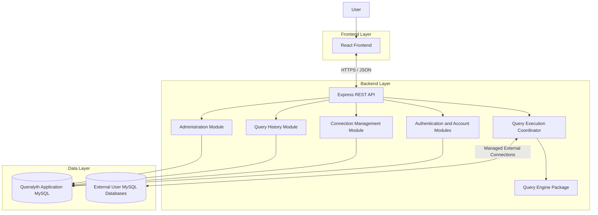

# Queralyth — System Architecture

**Document:** System Architecture  
**Project:** Queralyth  
**Version:** 1.0  
**Status:** Initial design baseline  
**Category:** Software Design Document (SDD)

---

## 1. Introduction

### 1.1 Purpose

This document defines the high-level system architecture of Queralyth, a MySQL-focused Database Intelligence and Optimization Platform.

It establishes the architectural structure, major system components, communication mechanisms, technology boundaries, and fundamental architectural decisions that guide implementation.

It serves as the architectural foundation for the detailed design documents.

### 1.2 Architectural Objectives

The architecture must:

1. Support the four core product pillars: Understand, Analyze, Experiment, and Improve.
2. Provide a clear separation between frontend, backend, and query-engine responsibilities.
3. Support individual user accounts and user-specific resources.
4. Securely connect to external MySQL databases.
5. Support SQL analysis, execution-plan interpretation, and query execution.
6. Protect database credentials and user information.
7. Maintain reliable query execution tracking and recovery.
8. Remain maintainable and extensible without introducing unnecessary infrastructure.
9. Support the initial zero-cost hosting constraint.
10. Allow future product capabilities without requiring a complete architectural redesign.

---

## 2. Architectural Style

### 2.1 Modular Monolith

Queralyth will initially use a **modular monolithic architecture**.

The backend will operate as one Node.js and Express application, organized into clearly separated functional modules.

Each module will have defined responsibilities and controlled interactions with other modules.

The architecture will not use microservices for the initial product lifecycle.

### 2.2 Rationale

A modular monolith provides:

- Simpler initial development and deployment.
- Lower infrastructure and operational complexity.
- Easier transaction management.
- Clear separation of business responsibilities.
- Reduced communication overhead between internal components.
- Flexibility to reorganize or extract components in the future if justified.

The architecture prioritizes maintainability and simplicity over premature distribution.

### 2.3 Architectural Boundaries

The initial system consists of three primary application areas:

1. Frontend application.
2. Backend application.
3. Query-engine package.

These are logically separated components, not independently deployed microservices.

---

## 3. High-Level System Components

### 3.1 Frontend Application

**Technology:** React with JavaScript (JSX).

The frontend provides the user-facing interface for Queralyth.

Its responsibilities include:

- User registration and login interfaces.
- Account and session-related interfaces.
- Saved database connection management.
- SQL editor and query submission.
- SQL analysis presentation.
- Logical operator-tree visualization.
- MySQL execution-plan visualization.
- Query execution results.
- Query-history management.
- Optimization recommendations and related interfaces.

The frontend communicates with the backend through REST APIs.

It must not directly access the application database or external user databases.

It must never receive database passwords, encryption keys, or other backend-only secrets.

### 3.2 Backend Application

**Technology:** Node.js with Express.

The backend implements Queralyth's application logic and coordinates interactions between the frontend, application database, query engine, and external MySQL databases.

Its responsibilities include:

- Authentication and session management.
- Authorization and user ownership enforcement.
- Account management.
- Saved database connection management.
- Credential encryption and decryption.
- SQL validation and execution coordination.
- Query-history persistence.
- Execution-request management and idempotency.
- Application database access.
- Error handling and recovery coordination.
- Rate limiting and resource protection.

The backend is the authoritative enforcement layer for security and business rules.

### 3.3 Query Engine

The query engine will be maintained as a logically separate, reusable package within the project.

Its responsibilities include:

- SQL parsing.
- SQL structure inspection.
- Logical representation generation.
- SQL-related validation support.
- Execution-plan interpretation.
- Optimization-analysis support.

The query engine will initially focus exclusively on MySQL.

It will not replace the MySQL optimizer. It will interpret and analyze database information to provide additional understanding and optimization guidance.

Detailed query-engine behavior will be documented in `06-Query-Execution-Engine.md`.

---

## 4. Application Database and External Databases

### 4.1 Application Database

Queralyth will use MySQL 8.x for its own application data.

It stores information such as:

- User accounts.
- Sessions.
- Saved database connections.
- Query history.
- Email verification tokens.
- Account status history.
- Administrator audit logs.
- Execution-request records.

The detailed schema and relationships are defined in `03-Database-Design.md`.

### 4.2 External User Databases

Users can save connection configurations for external MySQL databases.

The backend establishes and manages these connections when users perform supported operations.

External databases are distinct from Queralyth's application database.

The application database stores connection configuration and protected credential data, while external databases contain the users' actual database schemas and query data.

### 4.3 Database Separation

Application database operations and external query execution will use separate connection-pool management.

This prevents slow external queries from exhausting resources needed for core application functionality.

---

## 5. High-Level Architecture Diagram

The following diagram illustrates the major components and their relationships.

This is a logical architecture diagram. It does not prescribe the final internal module structure or every individual API interaction.

---

## 6. Communication Architecture

### 6.1 Frontend-to-Backend Communication

The frontend and backend will communicate through REST APIs.

Communication characteristics:

- HTTP request/response model.
- JSON request and response bodies.
- HTTPS in deployed environments.
- Server-managed authentication sessions.
- Secure session cookies.
- Backend authorization and ownership validation.

### 6.2 Backend-to-Application-Database Communication

The backend communicates with the application database using a managed MySQL connection pool.

Database operations will use:

- Parameterized SQL.
- Explicit transaction boundaries.
- Appropriate constraints.
- Controlled connection acquisition.
- Backend-enforced access policies.

### 6.3 Backend-to-External-Database Communication

The backend communicates directly with external MySQL databases using separately managed connections.

These operations must follow the approved connection-security, query-validation, concurrency, and execution-lifecycle rules.

### 6.4 Internal Component Communication

Backend modules will communicate through defined internal interfaces and function-level interactions.

The initial architecture does not require network communication between internal modules.

---

## 7. Authentication and Security Boundaries

Security is enforced primarily by the backend.

Architectural security requirements include:

1. Server-managed sessions using secure cookies.
2. Argon2id password hashing.
3. Backend-only credential encryption and decryption.
4. AES-256-GCM for saved database-password encryption.
5. Authorization checks on user-owned resources.
6. CSRF protections for session-authenticated requests.
7. Restricted external database destinations to mitigate SSRF.
8. Least-privilege database credentials.
9. Sensitive-data protection in logs and error responses.
10. HTTPS for deployed application communication.

Detailed policies will be maintained in `05-Authentication-and-Security.md`.

---

## 8. Architectural Constraints

The initial architecture must respect the following constraints:

| Area | Decision |
|---|---|
| Frontend | React with JavaScript |
| Backend | Node.js and Express |
| Database focus | MySQL 8.x |
| Architecture | Modular monolith |
| Internal query engine | Separate logical package |
| Communication | REST APIs and JSON |
| Authentication | Server-managed sessions |
| Initial hosting budget | $0/month |
| Deployment approach | Portable, provider-independent design |
| Microservices | Not included in initial architecture |

The design must avoid unnecessary paid infrastructure dependencies.

A zero-cost deployment is an initial constraint, not a guarantee that a production-scale service can operate indefinitely without infrastructure limitations.

---

## 9. Architectural Decisions Deferred to Detailed Design

The following subjects require their own detailed design specifications:

- Exact frontend and backend directory structures.
- Backend module interfaces and responsibilities.
- REST endpoint definitions.
- SQL parser library selection.
- Query-engine internal algorithms.
- Detailed database schema and DDL.
- Execution-plan visualization implementation.
- Deployment provider selection.
- Production infrastructure configuration.
- Detailed testing architecture.

These decisions must be finalized in their respective design documents rather than prematurely specified here.

---

## 10. Architectural Evolution

The modular monolith is the initial architecture, not an unconditional permanent restriction.

Future architectural changes may be considered if supported by measurable requirements, such as:

- Increased execution workload.
- Independent scaling requirements.
- Deployment isolation needs.
- Strong operational reasons to separate a component.

Any major architectural change must be documented, justified, and reflected in the relevant technical decision records.

---

## 11. Related Design Documents

| Document | Relationship |
|---|---|
| `02-Component-Design.md` | Detailed frontend, backend, and query-engine structure |
| `03-Database-Design.md` | Application database schema |
| `04-API-Design.md` | REST API contracts |
| `05-Authentication-and-Security.md` | Security architecture |
| `06-Query-Execution-Engine.md` | SQL processing and execution |
| `07-Concurrency-and-Transactions.md` | Transaction and concurrency policies |
| `08-Performance-and-Scalability.md` | Performance and resource management |
| `09-Deployment-and-Infrastructure.md` | Deployment architecture |
| `10-Error-Handling-and-Recovery.md` | Failure and recovery behavior |
| `11-Testing-and-Quality-Strategy.md` | Verification strategy |
| `12-Technical-Decision-Records.md` | Architectural decision history |

---

## 12. Document Maintenance

This document represents the current high-level architectural baseline.

Any material architectural change must be reflected here and cross-checked against the detailed design documents.

Implementation details must not silently contradict the approved architecture.

## Audit-approved architecture clarification — built-in sample database

The built-in sample database is a backend-managed MySQL 8.x target, logically separate from the Queralyth application schema. The initial deployment may place the sample schema on the same physical MySQL server as the application database if required by the zero-cost hosting constraint, but it must use a distinct schema and a dedicated read-only database account. The application database account and sample-query account must be separate; the sample account must not have privileges on the application schema.

The backend maintains a dedicated sample-database connection configuration/pool. This is a trusted, deployment-configured target, not a user-supplied host and not a row in the user's saved `connections` collection. The frontend selects a distinct built-in target identifier; the backend maps that identifier to its configured connection. Existing SQL validation, execution limits, cancellation, concurrency controls, and history rules apply. The sample dataset is synthetic and version-controlled. Per-user writable clones or isolated experiment databases are deferred to the Optimization Lab.

The MVP deployment is a single backend instance for process-local temporary result caching. Multi-instance deployment requires revisiting result-cache sharing or routing before horizontal scaling.

