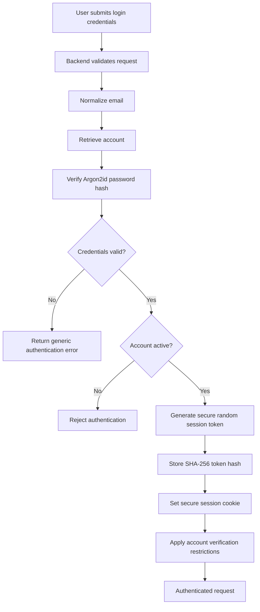

# Queralyth — Authentication and Security

**Document:** Authentication and Security  
**Project:** Queralyth  
**Version:** 1.0  
**Status:** Consolidated security design baseline  
**Backend:** Node.js + Express  
**Frontend:** React (JavaScript)  
**Database:** MySQL 8.x

---

## 1. Introduction

### 1.1 Purpose

This document defines the authentication, authorization, application security, data protection, and operational security requirements for Queralyth.

It establishes how the system protects:

- User accounts and authentication sessions.
- Saved external MySQL connection configurations.
- Database credentials.
- Query statements and execution results.
- User-owned application resources.
- Administrator operations.
- Backend infrastructure and application data.

### 1.2 Security Objectives

Queralyth must provide:

1. Confidentiality of user credentials and private data.
2. Integrity of account and database operations.
3. Authentication of individual users.
4. Authorization based on account ownership and role.
5. Protection against unauthorized SQL execution.
6. Isolation between users and their resources.
7. Controlled session and account lifecycles.
8. Secure handling of sensitive information.
9. Recoverable and auditable security operations.

### 1.3 Security Principles

The following principles guide implementation:

- Defense in depth.
- Least privilege.
- Secure defaults.
- Server-side validation.
- Explicit authorization.
- Fail securely.
- Minimize stored sensitive information.
- Never trust frontend validation alone.
- Keep secrets outside source control.
- Separate authentication, authorization, and execution responsibilities.

---

## 2. Authentication Architecture

### 2.1 Authentication Model

Queralyth uses server-managed sessions with secure cookies.

JWT-based browser authentication with tokens stored in localStorage is not part of the selected architecture.

The backend is responsible for establishing, validating, refreshing, and revoking sessions.

### 2.2 Authentication Flow

### 2.3 Session Token Requirements

- Generate tokens using a cryptographically secure random generator.
- Use an opaque token with sufficient entropy.
- Store only the SHA-256 digest in the `sessions` table.
- Never store the raw session token in the database.
- Never expose the token in application responses or logs.
- Transmit it only through the configured secure cookie.
- Validate the session against its server-side record on authenticated requests.

The database session identifier is separate from the browser's opaque session token.

The backend must not trust a client-supplied session identifier as proof of authentication.

### 2.4 Session Cookie Configuration

The session cookie must use:

| Attribute | Requirement |
|---|---|
| HttpOnly | Enabled |
| Secure | Enabled in HTTPS deployment |
| SameSite | Lax by default, or stricter where compatible |
| Domain | Restricted to the required application domain |
| Path | Restricted appropriately |
| Expiry | Consistent with server-side session policy |

If a cross-site deployment requires `SameSite=None`, the cookie must also use `Secure`, and CSRF protection and CORS restrictions must be configured accordingly.

The cookie's expiration must not extend the lifetime of the corresponding server-side session.

### 2.5 Session Expiration

Two expiration mechanisms apply:

- Idle expiration: 7 days without activity.
- Absolute expiration: 30 days after login.

Activity refreshes the idle expiration only.

The idle expiration must never extend beyond the absolute expiration.

Absolute expiration cannot be extended by continued activity.

All expiration timestamps are calculated and validated by the backend using UTC.

An expired session must be rejected even if the browser continues to send its cookie.

### 2.6 Multiple Sessions

Multiple active sessions per account are permitted.

Users can:

- View their active sessions.
- Revoke an individual session.
- Revoke other sessions.
- Log out from the current session.

Revoked sessions cannot be reactivated.

Session-management operations must validate ownership. A user cannot revoke another user's session by supplying or guessing its identifier.

### 2.7 Session Revocation Events

All active sessions are revoked when:

- The user changes their password.
- The account is suspended.
- An authorized administrator performs a security-related revocation.
- A security incident requires session invalidation.

A password change requires the user to authenticate again.

The backend checks session validity and account status on authenticated requests.

Session revocation and the associated security-sensitive database changes must be performed transactionally where required.

### 2.8 Unverified Account Sessions

Email verification is required before protected Queralyth functionality becomes available.

An account with valid login credentials, an active account status, and an unverified email address may establish a limited authenticated session.

The limited session allows access only to permitted account-verification functionality, including:

- Retrieving the current verification status.
- Requesting a new verification email, subject to rate limits.
- Submitting an email verification token.
- Accessing other explicitly permitted account-verification operations.

An unverified account cannot access protected product functionality, including:

- Saved database connections.
- SQL analysis and execution.
- Query history.
- Execution requests and results.
- Other protected user resources.
- Password-change functionality.

The backend must enforce these restrictions on every protected request.

Frontend navigation restrictions are supplementary and must never replace backend authorization.

Successful email verification changes the email-verification state. It does not change the account's `account_status`.

After successful email verification, the backend may permit normal protected functionality through the existing valid session, subject to the account's other authorization requirements.

The session must still satisfy normal expiration, revocation, account-status, and authorization checks.

---

## 3. Password Security

### 3.1 Password Hashing

Queralyth uses Argon2id for password hashing.

Passwords are never stored in plaintext.

The password hash is stored in:

`users.password_hash`

### 3.2 Password Handling

- Hash passwords on the backend.
- Never send password hashes to the frontend.
- Never log submitted passwords.
- Never include passwords in API error responses.
- Never store plaintext passwords in application databases.
- Use the configured Argon2id parameters and review them against current security guidance.
- Rehash passwords when parameters need upgrading and the password is successfully verified.

### 3.3 Password Change

The password-change workflow requires:

1. An authenticated session.
2. A verified email address.
3. Verification of the current password.
4. Validation of the new password.
5. Generation of a new Argon2id hash.
6. A transaction that updates the password and revokes all active sessions.
7. A security notification to the verified email address.

The user must log in again after the change.

An unverified account cannot use the password-change operation through its limited session.

### 3.4 Login Protection

The login system must implement:

- Account-based rate limiting.
- IP-based rate limiting.
- Progressive delays where appropriate.
- Generic authentication failure messages.
- Monitoring of suspicious login activity.

Permanent account lockout solely because of repeated failed attempts is not used.

Rate limiting must not reveal whether a particular email address is registered.

---

## 4. Authorization and User Isolation

### 4.1 Authorization Model

Queralyth uses role-based permissions together with resource ownership checks.

Initial roles:

- `user`
- `admin`

The role is stored in `users.role`.

### 4.2 User Permissions

A normal user can:

- Manage their own account.
- Manage their own sessions.
- Save and manage their own database connections.
- Analyze supported SQL.
- Execute authorized queries.
- View and manage their own query history.
- Manage supported account preferences.

A normal user cannot:

- Access another user's resources.
- Change their own role.
- Access administrator endpoints.
- Bypass account-status restrictions.
- Retrieve another user's saved credentials.

Unverified users are additionally restricted according to Section 2.8.

### 4.3 Administrator Permissions

Administrators can perform explicitly authorized administrative operations, including:

- Viewing permitted account information.
- Suspending accounts.
- Restoring eligible accounts.
- Changing account roles.
- Initiating authorized account-deletion workflows.
- Reviewing administrative audit records.

Administrator permissions must not automatically grant unrestricted access to saved database passwords or private query contents.

Access to sensitive user data requires a separately authorized and auditable operation where such access is permitted by the product's policies.

### 4.4 Ownership Enforcement

The backend derives the authenticated user's identity from the validated session.

It must not trust a client-supplied `userId` as proof of ownership.

For every user-owned resource:

1. Authenticate the requester.
2. Retrieve the resource within the appropriate authorization context.
3. Validate ownership.
4. Check the requested operation's permissions.
5. Perform the operation.

Ownership checks apply to:

- Connections.
- Query-history records.
- Execution requests.
- Sessions.
- Account settings.
- Other user-specific resources.

Resource identifiers must never act as authorization credentials.

### 4.5 Resource Enumeration Protection

Where appropriate, requests for nonexistent and inaccessible user-owned resources should return indistinguishable responses.

This reduces the ability to discover another user's resource identifiers.

Authorization must still be enforced regardless of the response format used to reduce resource enumeration.

---

## 5. Account Verification and Status Security

### 5.1 Email Verification

Email verification is required before protected product functionality becomes available.

Verification tokens must:

- Be generated using secure randomness.
- Be stored only as SHA-256 hashes.
- Expire after 30 minutes.
- Be single-use.
- Be invalidated when superseded.
- Be rate-limited.

The raw token must never be stored in the application database or logs.

An unverified user may authenticate through a limited session as described in Section 2.8.

Successful verification must atomically validate and consume the applicable verification token and update the account's verification state.

Email verification does not change `account_status`.

### 5.2 Email Changes

An email change follows a verification-based workflow.

- The existing verified email remains active until verification succeeds.
- The proposed address is stored as a pending email.
- The new address must be verified before becoming the account email.
- Concurrent requests are serialized through the user record.
- A notification is sent to the previous verified address after a successful email change.

Verification messages must not contain passwords or session credentials.

A pending email address must not be treated as the account's verified address.

### 5.3 Account Status

Supported account statuses:

- `active`
- `suspended`
- `pending_deletion`

Suspended and pending-deletion accounts cannot perform normal protected operations.

Email verification status is enforced separately from account status.

An account's email-verification state must not be represented by changing its account status.

### 5.4 Suspension

Account suspension requires:

1. An authorized administrative or system workflow.
2. An account-status update.
3. Revocation of active sessions.
4. An account-status history record.
5. An administrator audit event when initiated by an administrator.

These database changes occur in the same transaction.

A suspended account cannot use an existing session to bypass the suspension.

### 5.5 Account Deletion

Account deletion requires:

- An authenticated session.
- Recent password confirmation where applicable.
- Explicit final confirmation.
- Blocking new protected operations.
- Session revocation according to the deletion workflow.
- Cancellation and resolution of active executions.
- Controlled permanent deletion.

Permanent deletion must not proceed while an external query may still be running or its termination remains uncertain.

Account deletion must remain blocked until associated execution requests have reached terminal states.

If cancellation or termination cannot be confirmed, the relevant execution must remain tracked in its unresolved state until recovery establishes its outcome.

The deletion workflow must not remove execution state or required execution snapshots while an associated execution remains unresolved.

Administrator audit records are preserved according to their retention policy.

---

## 6. External Database Credential Security

### 6.1 Credential Protection Strategy

Saved external MySQL passwords are encrypted using:

**AES-256-GCM authenticated encryption.**

This provides confidentiality and authentication of encrypted credential data.

Plaintext credentials must not be persisted in application database records.

### 6.2 Stored Encryption Fields

The `connections` table stores:

- `encrypted_password`
- `encryption_nonce`
- `encryption_auth_tag`
- `encryption_key_version`

The encryption key itself is not stored in the application database.

The exact physical representation must remain consistent with the Database Design document.

### 6.3 Encryption Requirements

- Use a unique nonce for each encryption operation under a given key.
- Use a 12-byte nonce.
- Store the authentication tag.
- Verify the authentication tag during decryption.
- Reject modified or unauthenticated ciphertext.
- Track the encryption-key version.
- Never reuse a nonce with the same AES-GCM key.
- Never expose encryption material to the frontend.
- Treat authentication-tag verification failure as a credential-integrity failure.

### 6.4 Key Management

Initial MVP approach:

- Store the encryption key as a protected backend environment secret.
- Never hardcode it.
- Never commit it to Git.
- Never store it in the application database.
- Restrict access to the deployment environment.
- Maintain a documented key-rotation procedure.
- Securely back up the key separately from encrypted database backups.

Losing the encryption key can make stored credentials unrecoverable.

A dedicated Key Management Service may be considered later if product scale and hosting constraints justify it.

### 6.5 Credential Access

Only authorized backend components may decrypt saved credentials.

Credentials must not appear in:

- Frontend responses.
- Browser storage.
- Application logs.
- Error messages.
- Audit details.
- Analytics events.
- Debug output.

The backend should decrypt credentials only when an authorized operation requires them.

Decryption must occur within the backend's controlled execution path. Credential material must not be returned to the frontend.

### 6.6 Passwordless Connections

Passwordless connections are supported.

When no password is configured, all encryption-related fields remain NULL.

Empty password input is normalized to a passwordless configuration.

The backend must distinguish a deliberately passwordless configuration from a failed or incomplete encryption operation.

### 6.7 Encryption-Key Rotation

Credential-encryption keys are versioned.

Key rotation must preserve the ability to decrypt credentials encrypted under older supported key versions.

The backend must:

- Identify the key version associated with each encrypted credential.
- Retain older encryption keys while encrypted credentials still depend on them.
- Re-encrypt credentials under a newer key when required by the rotation procedure.
- Verify successful re-encryption before retiring an older key.
- Never expose encryption-key material through application data or logs.

Encrypted database backups must remain recoverable using the corresponding protected key versions.

### 6.8 Credential Encryption Failure

If credential decryption or authentication-tag verification fails:

- The backend must not attempt to use the unverified credential material.
- The operation must fail securely.
- Sensitive ciphertext and key material must not be exposed in the response.
- A sanitized security event may be recorded.
- The failure must not silently fall back to plaintext or another unverified credential source.

---

## 7. External Database Connection Security

### 7.1 Destination Validation

External database connections create a security boundary between Queralyth's infrastructure and user-specified network destinations.

The backend must validate destination addresses and enforce network restrictions.

### 7.2 SSRF Protection

The connection manager must prevent unauthorized access to:

- Internal infrastructure.
- Cloud metadata services.
- Restricted private network destinations.
- Loopback destinations not explicitly permitted.
- Other prohibited network ranges.

Validation must consider DNS resolution and address changes, not only the original hostname string.

All resolved destination addresses must be checked against the applicable network restrictions.

The backend must prevent DNS changes between validation and connection establishment from bypassing destination restrictions.

The network layer should enforce destination restrictions as an additional defense.

### 7.3 Connection Privileges

Users should connect using dedicated MySQL accounts with the minimum privileges needed for supported Queralyth operations.

The application must not assume that every user-provided MySQL account is safe.

Database privileges are an additional security boundary and do not replace backend SQL validation.

### 7.4 Connection Testing

Connection testing:

- Is initiated manually.
- Checks connectivity and authentication.
- Does not execute arbitrary SQL.
- Uses a 10-second connection-establishment timeout.
- Releases the test connection afterward.
- Stores results only if the configuration version remains unchanged.

A successful connection test does not guarantee future availability.

### 7.5 Connection Resource Isolation

Application database connections and external user-database connections use separate pools.

External database connections must not consume the application database pool.

External connection resources must be released according to the execution lifecycle and must not be released while an external query may still be active.

### 7.6 Connection Configuration Versioning

Every saved connection has a monotonically increasing `configVersion`.

A successful configuration update increments the version.

An execution accepted against a saved connection must be associated with the exact configuration version validated during acceptance.

A later connection update must not silently change the configuration used by an already-accepted execution.

The backend must ensure that the execution worker uses the accepted configuration snapshot rather than retrieving an unrelated newer configuration at execution time.

A stale configuration update must be rejected rather than silently overwriting a newer version.

The version must never wrap or reset.

### 7.7 Execution Configuration Snapshot

When an execution is accepted, the backend must securely bind it to the saved connection's accepted configuration version and the configuration required to execute that request.

For saved-connection executions, the backend must create an immutable, encrypted execution-configuration snapshot associated with the execution request.

The snapshot must:

- Preserve the exact accepted connection configuration.
- Correspond to one exact `configVersion`.
- Be associated with the corresponding execution request.
- Remain independent of subsequent connection edits.
- Remain usable by an already-accepted execution after the original saved connection is deleted.
- Be protected against unauthorized access and modification.
- Store required credential material only in encrypted form.
- Use AES-256-GCM authenticated encryption for protected credential material.
- Record the applicable encryption-key version.
- Never contain plaintext credentials.
- Never expose credentials or encryption material to the frontend.

The snapshot must be created as part of the execution-acceptance transaction, together with the execution claim, request fingerprint and key-version information, and required query-history record when history recording is enabled.

If snapshot creation or protection fails, the acceptance transaction must roll back. External execution must not begin.

The execution worker must use the accepted immutable snapshot. It must not retrieve the current mutable connection configuration as a replacement.

The snapshot must remain available until its associated execution request becomes eligible for cleanup.

Updating or deleting the original saved connection affects future operations, not the configuration already bound to an accepted execution.

New executions must use the latest valid saved configuration. Deleted connections cannot accept new executions.

For the built-in sample database, the backend resolves the target through deployment-managed configuration. A user-owned saved-connection snapshot is not required.

### 7.8 Snapshot and Credential Key Lifecycle

Execution snapshots and saved connection credentials must remain decryptable for as long as retained execution or connection records depend on their encryption-key versions.

The backend must not retire an encryption key while valid retained records still require it.

Snapshot cleanup must follow execution-request cleanup eligibility, not the lifecycle of the original saved connection.

Deleting or updating a saved connection must not delete or modify an accepted execution snapshot.

---

## 8. SQL Execution Security

### 8.1 Execution Philosophy

Queralyth is SELECT-focused in its initial MVP.

However, SELECT statements are not automatically safe.

Some SELECT forms, functions, and clauses may introduce side effects, locking behavior, or other security concerns.

Therefore, execution permission is based on parser-supported validation and an explicit allowlist rather than a simple statement keyword check.

### 8.2 SQL Validation

Before execution, the backend must:

1. Parse the SQL using the selected parser.
2. Validate the parsed structure.
3. Confirm that the statement belongs to the supported grammar.
4. Reject multiple statements.
5. Reject prohibited clauses and operations.
6. Apply execution limits.
7. Authorize the connection.
8. Pass only validated requests to the execution engine.

Malformed or unsupported statements are rejected.

### 8.3 Prohibited Operations

The MVP must reject unsupported operations, including:

- INSERT.
- UPDATE.
- DELETE.
- DDL statements.
- Stored procedure execution.
- Multiple-statement submissions.
- Unsupported locking clauses.
- File-output operations.
- Other parser-identified prohibited or side-effecting constructs.

The exact supported SQL grammar and allowlist belong in `06-Query-Execution-Engine.md`.

### 8.4 Database Privileges

SQL validation is not the only security boundary.

External MySQL credentials should have least-privilege permissions appropriate to the supported functionality.

The backend must not rely on frontend checks or a keyword blacklist as its only execution protection.

### 8.5 Execution Limits

The backend enforces:

- Query execution time limits.
- Result-size limits.
- Connection limits.
- Per-user concurrency limits.
- Per-connection concurrency limits.
- Request-size limits.
- Cancellation handling.

Initial concurrency limits:

| Scope | Maximum simultaneous queries |
|---|---:|
| Per user | 3 |
| Per saved connection | 2 |
| Global | Configurable to backend capacity |

Execution limits must be enforced by the backend and execution engine, not merely displayed in the frontend.

### 8.6 Cancellation

Cancellation is a controlled lifecycle operation.

- Receiving a cancellation request does not mean execution has stopped.
- The backend signals the execution worker.
- Termination must be confirmed.
- Only then may a running request become `cancelled`.
- If termination cannot be confirmed, use `recovery_required`.
- Resources must not be released while execution may still be active.

A cancellation response must not claim that a query has stopped merely because a cancellation request was accepted.

### 8.7 Idempotency

Every execution request uses a UUID.

The database enforces uniqueness within the authenticated user's account.

Repeated submissions using the same UUID must not initiate another execution.

An intentional rerun uses a new UUID.

Execution-request tracking remains active even when query-history recording is disabled.

The request fingerprint must be generated and verified consistently so that retries cannot change the target, SQL statement, or other execution-defining inputs.

The same UUID with a different request fingerprint must be rejected as an idempotency-key reuse conflict.

### 8.8 Cancellation Before Worker Start

An execution may be cancelled while its state is `claimed`, before the worker begins external execution.

The following atomic transition rule applies:

- Cancellation may transition `claimed` directly to `cancelled`.
- The worker may transition `claimed` to `running` only if it successfully acquires the state transition.
- The worker must not begin external execution before successfully transitioning the request to `running`.
- If cancellation wins the transition, the worker must not start the query.
- If the worker wins the transition, cancellation follows the normal running-execution cancellation process.

Only one transition may win.

If cancellation wins while the request is still `claimed`, the backend must establish that external execution never started before releasing reserved resources.

If the worker has already transitioned the request to `running`, the backend must confirm termination before marking it `cancelled`.

If termination cannot be confirmed, the request enters `recovery_required`.

This rule prevents a race in which a cancellation request is accepted but a worker subsequently starts the query anyway.

### 8.9 Execution Request Fingerprints

Execution request fingerprints use a keyed HMAC construction.

Each stored fingerprint is associated with a non-secret key-version identifier.

The `execution_requests` record includes:

`fingerprint_key_version`

This field identifies the HMAC key version used to generate the associated fingerprint. It must never contain key material.

For retries using an existing execution UUID:

1. Retrieve the existing execution request after ownership validation.
2. Read its stored fingerprint and `fingerprint_key_version`.
3. Select the corresponding protected backend HMAC key.
4. Recompute the incoming request fingerprint using that original key version.
5. Compare the result with the stored fingerprint.
6. Return the existing execution resource only when the fingerprints match.
7. Reject a different request using the same UUID.

A retry must not use the currently active HMAC key merely because a newer key has been introduced.

HMAC key rotation must preserve the ability to verify fingerprints for existing execution requests.

Previous HMAC keys must remain securely available for at least as long as retained execution records depend on them.

The backend must not retire an HMAC key while valid retained records still require that key for retry verification.

HMAC key material must never be stored in:

- The application database.
- Frontend responses.
- Browser storage.
- Application logs.
- Audit details.
- Analytics events.

The HMAC key lifecycle is separate from the AES credential-encryption key lifecycle.

---

## 9. Application and API Security

### 9.1 Transport Security

Production communication must use HTTPS.

Sensitive cookies must use Secure.

Plaintext transmission of passwords, session credentials, or database credentials is prohibited.

### 9.2 CSRF Protection

Because authentication uses cookies, state-changing endpoints require CSRF protection.

The implementation must use an appropriate token-based or equivalent protection mechanism.

SameSite cookies provide an additional layer, not a universal replacement for CSRF defenses.

### 9.3 CORS

CORS must:

- Allow only explicitly approved frontend origins.
- Avoid unrestricted wildcard origins when credentials are used.
- Allow only necessary methods and headers.
- Use credential settings consistent with the cookie deployment.
- Be configured separately for development and production.

### 9.4 Input Validation

All inputs must be validated on the backend.

Validation includes:

- Types and formats.
- Length restrictions.
- Identifier formats.
- Request sizes.
- Email normalization.
- Connection details.
- SQL structure.
- Pagination parameters.
- Supported state transitions.
- Configuration-version values.
- Execution UUIDs.

### 9.5 Injection Protection

Application database operations must use parameterized queries or safe query-builder mechanisms.

User-controlled values must not be interpolated into application SQL.

For external SQL execution, the parser and validation layer must enforce the supported query grammar.

### 9.6 HTTP Security Headers

The backend should apply appropriate security headers, including:

- Content-Security-Policy.
- X-Content-Type-Options.
- Referrer-Policy.
- Frame-ancestors restrictions through CSP.
- Other relevant headers based on the deployment environment.

---

## 10. Query History and Data Privacy

### 10.1 Stored SQL

Query history stores the original SQL statement for actual execution attempts when recording is enabled.

SQL statements may contain sensitive literal values.

Users must be warned not to include passwords, API keys, or other secrets in SQL statements.

### 10.2 Logging Policy

Full SQL statements are not logged by default.

Error messages are sanitized.

Detailed diagnostics, when necessary, are restricted to protected operational logs.

Automatic SQL redaction is not part of the initial approved design because it may be incomplete or misleading.

### 10.3 Retention

Query history has a default retention period of 90 days from `executed_at`, representing execution start.

Administrator audit records have a minimum retention of 365 days.

Terminal execution-request records are retained for 24 hours after completion.

Active and unresolved execution requests remain until resolved.

Execution snapshots must remain available for as long as their associated execution requests require them.

Temporary query-result cache entries have a default TTL of 15 minutes and are process-local rather than durable storage.

### 10.4 User Control

Users can disable query-history recording.

Disabling history affects future records, not existing ones.

Users can delete individual history records.

Execution tracking remains active regardless of the user's query-history recording preference.

### 10.5 Backups

Deleting a primary database record does not immediately remove every historical backup copy.

Backup retention, expiration, encryption, and access controls must be documented and implemented separately.

### 10.6 History Deletion During Execution

Query-history records and execution requests have independent lifecycles.

A user may delete a history record while its associated execution is still active.

Deleting a history record:

- Must not cancel the associated execution.
- Must not modify its execution-request state.
- Must not release execution resources.
- Must not delete the corresponding execution request.
- Must not delete the execution's required configuration snapshot.
- Must not prevent normal execution completion or recovery.

The execution request remains independently tracked until it reaches a terminal state.

The execution request is the authoritative record for execution lifecycle tracking.

If the associated history record no longer exists when execution completes, the backend must handle the missing record gracefully.

A terminal execution update must not fail solely because the history record has been deleted.

The backend must not automatically recreate a history record that the user has deleted.

If a physical relationship associates an execution request with an optional history record, deletion must not cascade-delete the execution request. The association must be cleared or set to NULL as specified by the Database Design.

History ownership must be validated before deletion.

This separation ensures that optional query-history management cannot interfere with execution lifecycle correctness.

---

## 11. Administrator Security

### 11.1 Administrative Authorization

Administrator endpoints require explicit backend authorization.

The frontend must not be treated as an authorization boundary.

### 11.2 Role Changes

- Public registration always creates a normal user.
- Users cannot self-promote.
- Role changes require an authorized administrative workflow.
- The backend prevents removal of the last active administrator.
- Role changes are audited.

### 11.3 Audit Logging

Administrator actions are recorded in `admin_audit_logs`.

Initial action identifiers:

- `suspend_user`
- `restore_user`
- `change_user_role`
- `initiate_account_deletion`
- `cancel_account_deletion`

Audit details use structured JSON.

Audit records are append-only through normal application operations.

Passwords, tokens, encryption keys, and database credentials must never be included.

### 11.4 Administrator IP Addresses

Store the administrator's client IP when reliably available.

Support IPv4 and IPv6.

Do not trust arbitrary client-provided forwarding headers.

Only correctly configured trusted proxies may determine the original client IP.

---

## 12. Secret and Environment Configuration

### 12.1 Secret Management

Sensitive configuration must be stored outside source control.

Examples include:

- Application database credentials.
- Credential-encryption keys.
- HMAC fingerprint keys.
- Session-related secrets.
- Email-service credentials.
- Other deployment secrets.

### 12.2 Environment Files

Local development may use environment files.

Rules:

- `.env` must not be committed.
- `.env.example` must contain placeholders only.
- Production secrets must be configured through protected hosting secrets.
- Secrets must not appear in build artifacts or frontend environment variables.
- Secret access must be restricted.

### 12.3 Configuration Separation

Development, testing, and production environments must use separate credentials and configurations.

Production data must be sanitized before being used in lower environments.

### 12.4 Cryptographic Key Separation

Credential-encryption keys and HMAC fingerprint keys serve different purposes.

They must be managed as separate secrets with independent versioning and rotation procedures.

A key intended for one cryptographic purpose must not be reused for another.

Key versions are identifiers, not key material, and may be stored with the corresponding encrypted data or fingerprint.

### 12.5 Key Availability and Recovery

Protected backups of cryptographic keys must be maintained separately from application database backups.

Recovery procedures must identify which key versions are required to restore encrypted credentials and verify retained execution fingerprints.

A backup is not considered fully recoverable merely because the database backup itself is intact.

---

## 13. Error Handling and Security Logging

### 13.1 Error Responses

Error responses must not expose:

- Passwords.
- Session tokens.
- Encryption keys.
- HMAC keys.
- Raw connection credentials.
- Internal database connection strings.
- Stack traces.
- Internal filesystem paths.
- Unnecessary infrastructure details.

### 13.2 Structured Logging

Operational logs may include:

- Request identifiers.
- Operation identifiers.
- Error categories.
- HTTP status codes.
- Execution lifecycle states.
- Timing information.
- Relevant non-sensitive identifiers.

Sensitive request bodies and raw credentials must not be logged.

### 13.3 Security Events

Relevant security events should be recorded for controlled investigation, including:

- Authentication failures at an appropriate aggregation level.
- Session revocation.
- Account suspension.
- Administrator actions.
- Credential-decryption failures.
- Repeated unauthorized resource access.
- Suspicious execution activity.
- Failed or abnormal execution recovery.
- Fingerprint verification failures.
- Unexpected execution-state transitions.

Security logs must themselves have restricted access and appropriate retention.

---

## 14. Database Security and Integrity

### 14.1 Database Access

- Use dedicated application database credentials.
- Apply least-privilege database permissions.
- Restrict production database access.
- Use parameterized SQL.
- Keep application and external database credentials separate.

### 14.2 Transactional Security Operations

Security-sensitive changes must use transactions where multiple records must remain consistent.

Examples:

- Password change and session revocation.
- Account suspension and session revocation.
- Account-status history and audit insertion.
- Email verification and token consumption.
- Role change and administrator audit insertion.
- Execution acceptance and creation of its required protected configuration snapshot.
- Execution acceptance and creation of the required query-history record when recording is enabled.

External database execution must not begin before the required application-database acceptance transaction commits successfully.

### 14.3 Encryption Backups

The encryption key must have a separate secure backup.

Encrypted credential backups are not recoverable without the corresponding key version.

Key rotation must preserve the ability to decrypt credentials encrypted under older supported key versions until re-encryption or retirement is complete.

### 14.4 Execution Acceptance and Configuration Integrity

Execution acceptance must preserve the association between:

- The execution request.
- The selected saved connection.
- The accepted connection configuration version.
- The required protected execution configuration.
- The applicable fingerprint and fingerprint-key version.

The backend must establish this association before external query execution begins.

For saved-connection executions, the accepted configuration snapshot is immutable and encrypted.

The execution request must reference the snapshot and must not silently switch to a different saved-connection configuration after acceptance.

The worker must use the accepted snapshot rather than reading the current mutable connection record.

The snapshot must remain available throughout the execution lifecycle, including recovery when execution state is unresolved.

The snapshot must not contain plaintext credentials.

For built-in sample database requests, the backend uses deployment-managed configuration instead of a user-owned saved-connection snapshot.

### 14.5 Execution and History Independence

Execution-request lifecycle updates must not depend on the continued existence of an optional query-history record.

The backend must handle a missing history record without corrupting execution state or incorrectly reporting execution failure.

The execution request remains the authoritative record for execution lifecycle tracking.

History deletion must not cancel execution, release execution resources, or delete its required configuration snapshot.

### 14.6 Fingerprint Integrity

The execution request's stored fingerprint and `fingerprint_key_version` must be maintained as one logical integrity association.

A fingerprint must not be verified using an unrelated key version.

When retrying an existing execution UUID, the backend must use the original stored fingerprint-key version to recompute and verify the incoming request fingerprint.

Key rotation must preserve the availability of the appropriate verification key for every retained execution request.

The fingerprint key version is a non-secret identifier and must never contain key material.

### 14.7 Execution Cancellation and Worker Coordination

The backend must coordinate cancellation and worker startup through atomic execution-state transitions.

The worker must transition an execution from `claimed` to `running` before beginning external query execution.

Cancellation may transition an execution from `claimed` to `cancelled` if it wins the atomic transition.

Only one transition may win.

If cancellation wins, the worker must not execute the query.

If the worker wins, cancellation follows the running-execution termination procedure.

A running execution must not be marked `cancelled` until external termination is confirmed.

Uncertain termination requires `recovery_required` and continued resource tracking.

---

## 15. Security Testing Requirements

Security testing must cover:

### Authentication

- Invalid credentials.
- Session expiration.
- Session revocation.
- Password-change behavior.
- Login rate limiting.
- Email verification.
- Limited-session restrictions for unverified accounts.
- Absolute session expiration despite continued activity.
- Rejection of suspended and pending-deletion accounts.

### Authorization

- Cross-user resource access.
- Unauthorized administrator operations.
- Role escalation attempts.
- Ownership checks on every resource type.
- Protected functionality restrictions for unverified accounts.
- Session ownership and revocation checks.

### Credential Protection

- Encryption and decryption correctness.
- Authentication-tag verification.
- Key-version handling.
- Passwordless connections.
- Absence of credentials in API responses and logs.
- Credential access after connection updates and deletion where an accepted execution still requires the configuration.
- Snapshot encryption and decryption.
- Snapshot availability after original connection deletion.
- Snapshot retention until execution-request cleanup eligibility.

### SQL Execution

- Multiple-statement rejection.
- Unsupported statement rejection.
- Prohibited clause rejection.
- SQL parser edge cases.
- Execution limits.
- Cancellation and recovery behavior.
- Cancellation racing with the `claimed` to `running` transition.
- Restricted database privileges.
- Execution against the accepted connection configuration version.
- Prevention of worker execution when cancellation wins.

### Idempotency and Fingerprint Security

- Same UUID with an identical request.
- Same UUID with a different request.
- Fingerprint key-version selection.
- HMAC key rotation with retained execution requests.
- Retry verification using the original stored HMAC key version.
- Rejection when the required historical key is unavailable.
- Absence of HMAC key material in the database, API responses, and logs.

### History and Execution Independence

- Deleting history during an active execution.
- Execution completion after history deletion.
- Recovery after history deletion.
- Ensuring deleted history is not recreated.
- Ensuring history deletion does not cancel execution.
- Ensuring history deletion does not remove execution snapshots.
- Handling a missing optional history association.

### Network Security

- Malformed destination rejection.
- Restricted address rejection.
- DNS resolution changes.
- Internal network destination restrictions.
- Connection timeout handling.
- Enforcement of destination restrictions at connection time.

### Application Security

- CSRF protection.
- CORS restrictions.
- Input validation.
- Injection resistance.
- Rate limiting.
- Secure error handling.
- Security-header configuration.

Security tests must include both automated tests and targeted manual verification.

---

## 16. Security Decisions and Future Improvements

### 16.1 Initial MVP Security Commitments

The following are part of the initial design:

- Server-managed sessions.
- Argon2id password hashing.
- Secure cookies.
- CSRF protection.
- Role and ownership authorization.
- Limited sessions for unverified accounts.
- AES-256-GCM credential encryption.
- Encrypted immutable execution-configuration snapshots.
- Separate encryption-key storage.
- Versioned HMAC request fingerprints.
- Original-key-version retry verification.
- Separate cryptographic key management by purpose.
- Backend SQL allowlisting.
- Least-privilege external database credentials.
- SSRF and destination restrictions.
- Query and result limits.
- Execution idempotency and cancellation.
- Atomic cancellation handling before worker start.
- Immutable execution configuration association.
- Independent history and execution lifecycles.
- Secure logging.
- Account and audit retention policies.

### 16.2 Future Improvements

Potential later improvements include:

- Dedicated Key Management Service.
- Stronger tamper-resistant audit storage.
- Advanced anomaly detection.
- Additional security monitoring.
- More sophisticated credential lifecycle management.
- Independent security assessment before broader production adoption.

These improvements must not be used as a reason to postpone the essential MVP security controls.

---

## 17. Related Documents

- `01-System-Architecture.md`
- `02-Component-Design.md`
- `03-Database-Design.md`
- `04-API-Design.md`
- `06-Query-Execution-Engine.md`
- `07-Concurrency-and-Transactions.md`
- `08-Performance-and-Scalability.md`
- `09-Deployment-and-Infrastructure.md`
- `10-Error-Handling-and-Recovery.md`
- `11-Testing-and-Quality-Strategy.md`
- `12-Technical-Decision-Records.md`

---

## 18. Document Maintenance

This document defines Queralyth's consolidated security baseline.

Security-related implementation changes must remain consistent with these requirements.

Any changes to approved security decisions must be documented in the relevant technical decision records.

### 18.1 Audit-Approved Temporary Result Confidentiality

Temporary query-result cache entries may contain user database data and must be treated as confidential.

Cache entries are keyed by authenticated user ID and execution-request ID; every retrieval performs normal authentication and ownership authorization.

Result contents must not appear in logs, analytics, error messages, or another user's response.

Entries expire after the 15-minute default TTL and are removed on eviction or process restart.

The cache is process-local and is not durable storage.

The backend must not treat possession of an execution-request ID as authorization to retrieve cached results.

