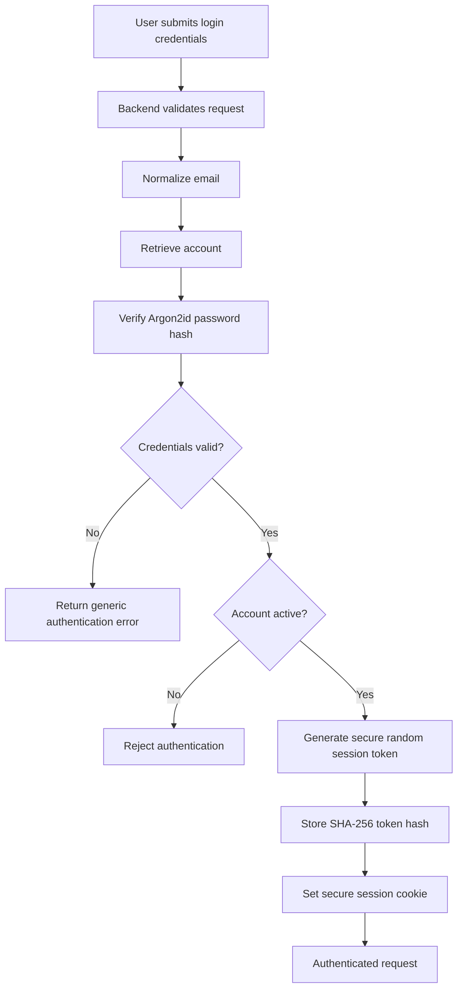

# Queralyth — Authentication and Security

**Document:** Authentication and Security  
**Project:** Queralyth  
**Version:** 1.0  
**Status:** Consolidated security design baseline  
**Backend:** Node.js + Express  
**Frontend:** React (JavaScript)  
**Database:** MySQL 8.x

---

## 1. Introduction

### 1.1 Purpose

This document defines the authentication, authorization, application security, data protection, and operational security requirements for Queralyth.

It establishes how the system protects:

- User accounts and authentication sessions.
- Saved external MySQL connection configurations.
- Database credentials.
- Query statements and execution results.
- User-owned application resources.
- Administrator operations.
- Backend infrastructure and application data.

### 1.2 Security Objectives

Queralyth must provide:

1. Confidentiality of user credentials and private data.
2. Integrity of account and database operations.
3. Authentication of individual users.
4. Authorization based on account ownership and role.
5. Protection against unauthorized SQL execution.
6. Isolation between users and their resources.
7. Controlled session and account lifecycles.
8. Secure handling of sensitive information.
9. Recoverable and auditable security operations.

### 1.3 Security Principles

The following principles guide implementation:

- Defense in depth.
- Least privilege.
- Secure defaults.
- Server-side validation.
- Explicit authorization.
- Fail securely.
- Minimize stored sensitive information.
- Never trust frontend validation alone.
- Keep secrets outside source control.
- Separate authentication, authorization, and execution responsibilities.

---

## 2. Authentication Architecture

### 2.1 Authentication Model

Queralyth uses server-managed sessions with secure cookies.

JWT-based browser authentication with tokens stored in localStorage is not part of the selected architecture.

The backend is responsible for establishing, validating, refreshing, and revoking sessions.

### 2.2 Authentication Flow

### 2.3 Session Token Requirements

- Generate tokens using a cryptographically secure random generator.
- Use an opaque token with sufficient entropy.
- Store only the SHA-256 digest in the `sessions` table.
- Never store the raw session token in the database.
- Never expose the token in application responses or logs.
- Transmit it only through the configured secure cookie.

The database session identifier is separate from the browser's opaque session token.

### 2.4 Session Cookie Configuration

The session cookie must use:

| Attribute | Requirement |
|---|---|
| HttpOnly | Enabled |
| Secure | Enabled in HTTPS deployment |
| SameSite | Lax by default, or stricter where compatible |
| Domain | Restricted to the required application domain |
| Path | Restricted appropriately |
| Expiry | Consistent with server-side session policy |

If a cross-site deployment requires `SameSite=None`, the cookie must also use `Secure`, and CSRF protection and CORS restrictions must be configured accordingly.

### 2.5 Session Expiration

Two expiration mechanisms apply:

- Idle expiration: 7 days without activity.
- Absolute expiration: 30 days after login.

Activity refreshes the idle expiration only.

Absolute expiration cannot be extended by continued activity.

All expiration timestamps are calculated and validated by the backend using UTC.

### 2.6 Multiple Sessions

Multiple active sessions per account are permitted.

Users can:

- View their active sessions.
- Revoke an individual session.
- Revoke other sessions.
- Log out from the current session.

Revoked sessions cannot be reactivated.

### 2.7 Session Revocation Events

All active sessions are revoked when:

- The user changes their password.
- The account is suspended.
- An authorized administrator performs a security-related revocation.
- A security incident requires session invalidation.

A password change requires the user to authenticate again.

The backend checks session validity and account status on authenticated requests.

---

## 3. Password Security

### 3.1 Password Hashing

Queralyth uses Argon2id for password hashing.

Passwords are never stored in plaintext.

The password hash is stored in:

`users.password_hash`

### 3.2 Password Handling

- Hash passwords on the backend.
- Never send password hashes to the frontend.
- Never log submitted passwords.
- Never include passwords in API error responses.
- Never store plaintext passwords in application databases.
- Use the configured Argon2id parameters and review them against current security guidance.
- Rehash passwords when parameters need upgrading and the password is successfully verified.

### 3.3 Password Change

The password-change workflow requires:

1. An authenticated session.
2. Verification of the current password.
3. Validation of the new password.
4. Generation of a new Argon2id hash.
5. A transaction that updates the password and revokes all active sessions.
6. A security notification to the verified email address.

The user must log in again after the change.

### 3.4 Login Protection

The login system must implement:

- Account-based rate limiting.
- IP-based rate limiting.
- Progressive delays where appropriate.
- Generic authentication failure messages.
- Monitoring of suspicious login activity.

Permanent account lockout solely because of repeated failed attempts is not used.

---

## 4. Authorization and User Isolation

### 4.1 Authorization Model

Queralyth uses role-based permissions together with resource ownership checks.

Initial roles:

- `user`
- `admin`

The role is stored in `users.role`.

### 4.2 User Permissions

A normal user can:

- Manage their own account.
- Manage their own sessions.
- Save and manage their own database connections.
- Analyze supported SQL.
- Execute authorized queries.
- View and manage their own query history.
- Manage supported account preferences.

A normal user cannot:

- Access another user's resources.
- Change their own role.
- Access administrator endpoints.
- Bypass account-status restrictions.
- Retrieve another user's saved credentials.

### 4.3 Administrator Permissions

Administrators can perform explicitly authorized administrative operations, including:

- Viewing permitted account information.
- Suspending accounts.
- Restoring eligible accounts.
- Changing account roles.
- Initiating authorized account-deletion workflows.
- Reviewing administrative audit records.

Administrator permissions must not automatically grant unrestricted access to saved database passwords or private query contents.

### 4.4 Ownership Enforcement

The backend derives the authenticated user's identity from the validated session.

It must not trust a client-supplied `userId` as proof of ownership.

For every user-owned resource:

1. Authenticate the requester.
2. Retrieve the resource.
3. Validate ownership.
4. Check the requested operation's permissions.
5. Perform the operation.

Ownership checks apply to:

- Connections.
- Query-history records.
- Execution requests.
- Sessions.
- Account settings.
- Other user-specific resources.

Resource identifiers must never act as authorization credentials.

### 4.5 Resource Enumeration Protection

Where appropriate, requests for nonexistent and inaccessible user-owned resources should return indistinguishable responses.

This reduces the ability to discover another user's resource identifiers.

---

## 5. Account Verification and Status Security

### 5.1 Email Verification

Email verification is required before protected product functionality becomes available.

Verification tokens must:

- Be generated using secure randomness.
- Be stored only as SHA-256 hashes.
- Expire after 30 minutes.
- Be single-use.
- Be invalidated when superseded.
- Be rate-limited.

The raw token must never be stored in the application database or logs.

### 5.2 Email Changes

An email change follows a verification-based workflow.

- The existing verified email remains active until verification succeeds.
- The proposed address is stored as a pending email.
- The new address must be verified before becoming the account email.
- Concurrent requests are serialized through the user record.
- A notification is sent to the previous verified address after a successful change.

Verification messages must not contain passwords or session credentials.

### 5.3 Account Status

Supported account statuses:

- `active`
- `suspended`
- `pending_deletion`

Suspended and pending-deletion accounts cannot perform normal protected operations.

### 5.4 Suspension

Account suspension requires:

1. An authorized administrative or system workflow.
2. An account-status update.
3. Revocation of active sessions.
4. An account-status history record.
5. An administrator audit event when initiated by an administrator.

These database changes occur in the same transaction.

### 5.5 Account Deletion

Account deletion requires:

- An authenticated session.
- Recent password confirmation.
- Explicit final confirmation.
- Session revocation.
- Blocking new operations.
- Cancellation and resolution of active executions.
- Controlled permanent deletion.

Permanent deletion must not proceed while an external query may still be running or its termination remains uncertain.

Administrator audit records are preserved according to their retention policy.

---

## 6. External Database Credential Security

### 6.1 Credential Protection Strategy

Saved external MySQL passwords are encrypted using:

**AES-256-GCM authenticated encryption.**

This provides confidentiality and authentication of encrypted credential data.

### 6.2 Stored Encryption Fields

The `connections` table stores:

- `encrypted_password`
- `encryption_nonce`
- `encryption_auth_tag`
- `encryption_key_version`

The encryption key itself is not stored in the application database.

### 6.3 Encryption Requirements

- Use a unique nonce for each encryption operation under a given key.
- Use a 12-byte nonce.
- Store the authentication tag.
- Verify the authentication tag during decryption.
- Reject modified or unauthenticated ciphertext.
- Track the encryption-key version.
- Never reuse a nonce with the same AES-GCM key.
- Never expose encryption material to the frontend.

### 6.4 Key Management

Initial MVP approach:

- Store the encryption key as a protected backend environment secret.
- Never hardcode it.
- Never commit it to Git.
- Never store it in the application database.
- Restrict access to the deployment environment.
- Maintain a documented key-rotation procedure.
- Securely back up the key separately from encrypted database backups.

Losing the encryption key can make stored credentials unrecoverable.

A dedicated Key Management Service may be considered later if product scale and hosting constraints justify it.

### 6.5 Credential Access

Only authorized backend components may decrypt saved credentials.

Credentials must not appear in:

- Frontend responses.
- Browser storage.
- Application logs.
- Error messages.
- Audit details.
- Analytics events.
- Debug output.

The backend should decrypt credentials only when an authorized operation requires them.

### 6.6 Passwordless Connections

Passwordless connections are supported.

When no password is configured, all encryption-related fields remain NULL.

Empty password input is normalized to a passwordless configuration.

---

## 7. External Database Connection Security

### 7.1 Destination Validation

External database connections create a security boundary between Queralyth's infrastructure and user-specified network destinations.

The backend must validate destination addresses and enforce network restrictions.

### 7.2 SSRF Protection

The connection manager must prevent unauthorized access to:

- Internal infrastructure.
- Cloud metadata services.
- Restricted private network destinations.
- Loopback destinations not explicitly permitted.
- Other prohibited network ranges.

Validation must consider DNS resolution and address changes, not only the original hostname string.

The network layer should enforce destination restrictions as an additional defense.

### 7.3 Connection Privileges

Users should connect using dedicated MySQL accounts with the minimum privileges needed for supported Queralyth operations.

The application must not assume that every user-provided MySQL account is safe.

### 7.4 Connection Testing

Connection testing:

- Is initiated manually.
- Checks connectivity and authentication.
- Does not execute arbitrary SQL.
- Uses a 10-second connection-establishment timeout.
- Releases the test connection afterward.
- Stores results only if the configuration version remains unchanged.

A successful connection test does not guarantee future availability.

### 7.5 Connection Resource Isolation

Application database connections and external user-database connections use separate pools.

External database connections must not consume the application database pool.

---

## 8. SQL Execution Security

### 8.1 Execution Philosophy

Queralyth is SELECT-focused in its initial MVP.

However, SELECT statements are not automatically safe.

Some SELECT forms, functions, and clauses may introduce side effects, locking behavior, or other security concerns.

Therefore, execution permission is based on parser-supported validation and an explicit allowlist rather than a simple statement keyword check.

### 8.2 SQL Validation

Before execution, the backend must:

1. Parse the SQL using the selected parser.
2. Validate the parsed structure.
3. Confirm that the statement belongs to the supported grammar.
4. Reject multiple statements.
5. Reject prohibited clauses and operations.
6. Apply execution limits.
7. Authorize the connection.
8. Pass only validated requests to the execution engine.

Malformed or unsupported statements are rejected.

### 8.3 Prohibited Operations

The MVP must reject unsupported operations, including:

- INSERT.
- UPDATE.
- DELETE.
- DDL statements.
- Stored procedure execution.
- Multiple-statement submissions.
- Unsupported locking clauses.
- File-output operations.
- Other parser-identified prohibited or side-effecting constructs.

The exact supported SQL grammar and allowlist belong in `06-Query-Execution-Engine.md`.

### 8.4 Database Privileges

SQL validation is not the only security boundary.

External MySQL credentials should have least-privilege permissions appropriate to the supported functionality.

The backend must not rely on frontend checks or a keyword blacklist as its only execution protection.

### 8.5 Execution Limits

The backend enforces:

- Query execution time limits.
- Result-size limits.
- Connection limits.
- Per-user concurrency limits.
- Per-connection concurrency limits.
- Request-size limits.
- Cancellation handling.

Initial concurrency limits:

| Scope | Maximum simultaneous queries |
|---|---:|
| Per user | 3 |
| Per saved connection | 2 |
| Global | Configurable to backend capacity |

### 8.6 Cancellation

Cancellation is a controlled lifecycle operation.

- Receiving a cancellation request does not mean execution has stopped.
- The backend signals the execution worker.
- Termination must be confirmed.
- Only then may the request become `cancelled`.
- If termination cannot be confirmed, use `recovery_required`.
- Resources must not be released while execution may still be active.

### 8.7 Idempotency

Every execution request uses a UUID.

The database enforces uniqueness within the authenticated user's account.

Repeated submissions using the same UUID must not initiate another execution.

An intentional rerun uses a new UUID.

Execution-request tracking remains active even when query-history recording is disabled.

---

## 9. Application and API Security

### 9.1 Transport Security

Production communication must use HTTPS.

Sensitive cookies must use Secure.

Plaintext transmission of passwords, session credentials, or database credentials is prohibited.

### 9.2 CSRF Protection

Because authentication uses cookies, state-changing endpoints require CSRF protection.

The implementation must use an appropriate token-based or equivalent protection mechanism.

SameSite cookies provide an additional layer, not a universal replacement for CSRF defenses.

### 9.3 CORS

CORS must:

- Allow only explicitly approved frontend origins.
- Avoid unrestricted wildcard origins when credentials are used.
- Allow only necessary methods and headers.
- Use credential settings consistent with the cookie deployment.
- Be configured separately for development and production.

### 9.4 Input Validation

All inputs must be validated on the backend.

Validation includes:

- Types and formats.
- Length restrictions.
- Identifier formats.
- Request sizes.
- Email normalization.
- Connection details.
- SQL structure.
- Pagination parameters.
- Supported state transitions.

### 9.5 Injection Protection

Application database operations must use parameterized queries or safe query-builder mechanisms.

User-controlled values must not be interpolated into application SQL.

For external SQL execution, the parser and validation layer must enforce the supported query grammar.

### 9.6 HTTP Security Headers

The backend should apply appropriate security headers, including:

- Content-Security-Policy.
- X-Content-Type-Options.
- Referrer-Policy.
- Frame-ancestors restrictions through CSP.
- Other relevant headers based on the deployment environment.

---

## 10. Query History and Data Privacy

### 10.1 Stored SQL

Query history stores the original SQL statement for actual execution attempts when recording is enabled.

SQL statements may contain sensitive literal values.

Users must be warned not to include passwords, API keys, or other secrets in SQL statements.

### 10.2 Logging Policy

Full SQL statements are not logged by default.

Error messages are sanitized.

Detailed diagnostics, when necessary, are restricted to protected operational logs.

Automatic SQL redaction is not part of the initial approved design because it may be incomplete or misleading.

### 10.3 Retention

Query history has a default retention period of 90 days from execution start.

Administrator audit records have a minimum retention of 365 days.

Terminal execution-request records are retained for 24 hours after completion.

Active and unresolved execution requests remain until resolved.

### 10.4 User Control

Users can disable query-history recording.

Disabling history affects future records, not existing ones.

Users can delete individual history records.

### 10.5 Backups

Deleting a primary database record does not immediately remove every historical backup copy.

Backup retention, expiration, encryption, and access controls must be documented and implemented separately.

---

## 11. Administrator Security

### 11.1 Administrative Authorization

Administrator endpoints require explicit backend authorization.

The frontend must not be treated as an authorization boundary.

### 11.2 Role Changes

- Public registration always creates a normal user.
- Users cannot self-promote.
- Role changes require an authorized administrative workflow.
- The backend prevents removal of the last active administrator.
- Role changes are audited.

### 11.3 Audit Logging

Administrator actions are recorded in `admin_audit_logs`.

Initial action identifiers:

- `suspend_user`
- `restore_user`
- `change_user_role`
- `initiate_account_deletion`
- `cancel_account_deletion`

Audit details use structured JSON.

Audit records are append-only through normal application operations.

Passwords, tokens, encryption keys, and database credentials must never be included.

### 11.4 Administrator IP Addresses

Store the administrator's client IP when reliably available.

Support IPv4 and IPv6.

Do not trust arbitrary client-provided forwarding headers.

Only correctly configured trusted proxies may determine the original client IP.

---

## 12. Secret and Environment Configuration

### 12.1 Secret Management

Sensitive configuration must be stored outside source control.

Examples include:

- Application database credentials.
- Credential-encryption key.
- Session-related secrets.
- Email-service credentials.
- Other deployment secrets.

### 12.2 Environment Files

Local development may use environment files.

Rules:

- `.env` must not be committed.
- `.env.example` must contain placeholders only.
- Production secrets must be configured through protected hosting secrets.
- Secrets must not appear in build artifacts or frontend environment variables.
- Secret access must be restricted.

### 12.3 Configuration Separation

Development, testing, and production environments must use separate credentials and configurations.

Production data must be sanitized before being used in lower environments.

---

## 13. Error Handling and Security Logging

### 13.1 Error Responses

Error responses must not expose:

- Passwords.
- Session tokens.
- Encryption keys.
- Raw connection credentials.
- Internal database connection strings.
- Stack traces.
- Internal filesystem paths.
- Unnecessary infrastructure details.

### 13.2 Structured Logging

Operational logs may include:

- Request identifiers.
- Operation identifiers.
- Error categories.
- HTTP status codes.
- Execution lifecycle states.
- Timing information.
- Relevant non-sensitive identifiers.

Sensitive request bodies and raw credentials must not be logged.

### 13.3 Security Events

Relevant security events should be recorded for controlled investigation, including:

- Authentication failures at an appropriate aggregation level.
- Session revocation.
- Account suspension.
- Administrator actions.
- Credential-decryption failures.
- Repeated unauthorized resource access.
- Suspicious execution activity.

Security logs must themselves have restricted access and appropriate retention.

---

## 14. Database Security and Integrity

### 14.1 Database Access

- Use dedicated application database credentials.
- Apply least-privilege database permissions.
- Restrict production database access.
- Use parameterized SQL.
- Keep application and external database credentials separate.

### 14.2 Transactional Security Operations

Security-sensitive changes must use transactions where multiple records must remain consistent.

Examples:

- Password change and session revocation.
- Account suspension and session revocation.
- Account-status history and audit insertion.
- Email verification and token consumption.
- Role change and administrator audit insertion.

### 14.3 Encryption Backups

The encryption key must have a separate secure backup.

Encrypted credential backups are not recoverable without the corresponding key version.

Key rotation must preserve the ability to decrypt credentials encrypted under older supported key versions until re-encryption or retirement is complete.

---

## 15. Security Testing Requirements

Security testing must cover:

### Authentication
- Invalid credentials.
- Session expiration.
- Session revocation.
- Password-change behavior.
- Login rate limiting.
- Email verification.

### Authorization
- Cross-user resource access.
- Unauthorized administrator operations.
- Role escalation attempts.
- Ownership checks on every resource type.

### Credential Protection
- Encryption and decryption correctness.
- Authentication-tag verification.
- Key-version handling.
- Passwordless connections.
- Absence of credentials in API responses and logs.

### SQL Execution
- Multiple-statement rejection.
- Unsupported statement rejection.
- Prohibited clause rejection.
- SQL parser edge cases.
- Execution limits.
- Cancellation and recovery behavior.
- Restricted database privileges.

### Network Security
- Malformed destination rejection.
- Restricted address rejection.
- DNS resolution changes.
- Internal network destination restrictions.
- Connection timeout handling.

### Application Security
- CSRF protection.
- CORS restrictions.
- Input validation.
- Injection resistance.
- Rate limiting.
- Secure error handling.

Security tests must include both automated tests and targeted manual verification.

---

## 16. Security Decisions and Future Improvements

### 16.1 Initial MVP Security Commitments

The following are part of the initial design:

- Server-managed sessions.
- Argon2id password hashing.
- Secure cookies.
- CSRF protection.
- Role and ownership authorization.
- AES-256-GCM credential encryption.
- Separate encryption-key storage.
- Backend SQL allowlisting.
- Least-privilege external database credentials.
- SSRF and destination restrictions.
- Query and result limits.
- Execution idempotency and cancellation.
- Secure logging.
- Account and audit retention policies.

### 16.2 Future Improvements

Potential later improvements include:

- Dedicated Key Management Service.
- Stronger tamper-resistant audit storage.
- Advanced anomaly detection.
- Additional security monitoring.
- More sophisticated credential lifecycle management.
- Independent security assessment before broader production adoption.

These improvements must not be used as a reason to postpone the essential MVP security controls.

---

## 17. Related Documents

- `01-System-Architecture.md`
- `02-Component-Design.md`
- `03-Database-Design.md`
- `04-API-Design.md`
- `06-Query-Execution-Engine.md`
- `07-Concurrency-and-Transactions.md`
- `08-Performance-and-Scalability.md`
- `09-Deployment-and-Infrastructure.md`
- `10-Error-Handling-and-Recovery.md`
- `11-Testing-and-Quality-Strategy.md`
- `12-Technical-Decision-Records.md`

---

## 18. Document Maintenance

This document defines Queralyth's consolidated security baseline.

Security-related implementation changes must remain consistent with these requirements.

Any changes to approved security decisions must be documented in the relevant technical decision records.

## Audit-approved temporary result confidentiality

Temporary query-result cache entries may contain user database data and must be treated as confidential. Cache entries are keyed by authenticated user ID and execution-request ID; every retrieval performs normal authentication and ownership authorization. Result contents must not appear in logs, analytics, error messages, or another user's response. Entries expire after the 15-minute default TTL and are removed on eviction or process restart. The cache is process-local and is not durable storage.

