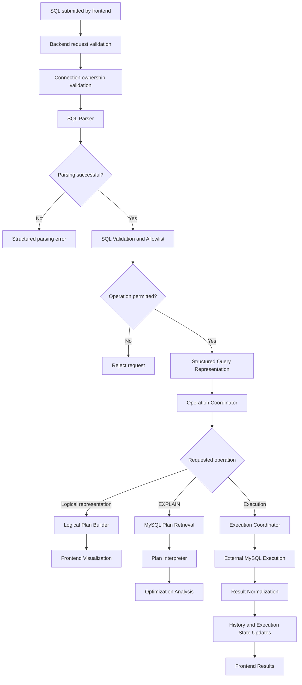
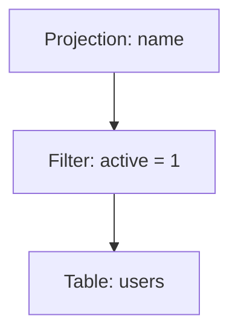
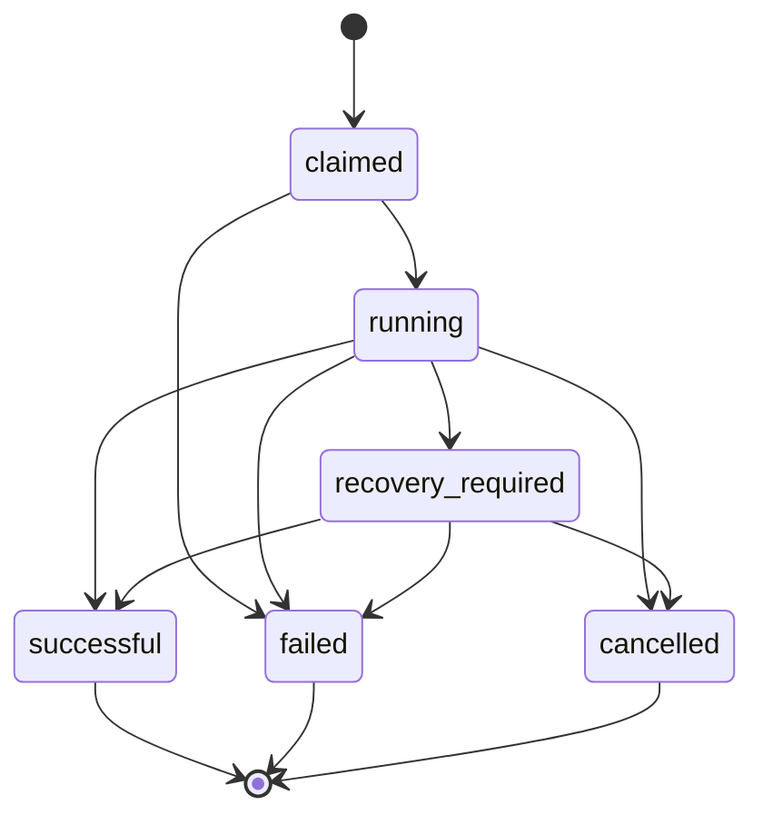

# Queralyth — Query Execution Engine

**Document:** Query Execution Engine  
**Project:** Queralyth  
**Version:** 1.0  
**Status:** Consolidated design baseline  
**Primary Database:** MySQL 8.x  
**Backend Runtime:** Node.js  
**Backend Framework:** Express  
**Frontend:** React (JavaScript)

---

## 1. Introduction

### 1.1 Purpose

This document defines the internal architecture and operational behavior of the Queralyth Query Execution Engine.

The engine is responsible for transforming user-submitted SQL into structured information that Queralyth can analyze, visualize, execute when authorized, and use to generate optimization recommendations.

It is one of the core components responsible for delivering Queralyth's product value.

### 1.2 Responsibilities

The Query Execution Engine is responsible for:

1. SQL parsing.
2. SQL validation and supported-statement enforcement.
3. Logical query representation.
4. MySQL execution-plan retrieval.
5. Execution-plan interpretation.
6. Query execution coordination.
7. Execution-result normalization.
8. Query timing and statistics.
9. Cancellation coordination.
10. Optimization analysis input preparation.

### 1.3 Design Philosophy

The engine must distinguish between three different operations:

- **Understanding:** Parsing SQL and constructing a logical representation.
- **Analyzing:** Obtaining and interpreting MySQL execution-plan information.
- **Executing:** Running an authorized query against an external MySQL database.

These operations have different security, resource, and persistence requirements.

A parsing or analysis request must not accidentally become an ordinary query-execution request.

---

## 2. High-Level Engine Architecture

### 2.1 Engine Pipeline



### 2.2 Architectural Separation

The engine must keep these responsibilities logically separate:

| Component | Responsibility |
|---|---|
| SQL Parser | Converts SQL into a structured representation |
| SQL Validator | Determines whether the parsed query is supported and permitted |
| Logical Plan Builder | Builds the supported logical operator tree |
| Plan Retriever | Obtains MySQL EXPLAIN information |
| Plan Interpreter | Converts MySQL plan information into Queralyth's internal representation |
| Execution Coordinator | Manages actual query execution |
| Result Normalizer | Converts driver results into consistent API data |
| Optimization Analyzer | Uses available evidence to produce recommendations |

These components may initially exist within one backend application, but their responsibilities must remain clearly separated.

---

## 3. SQL Parsing

### 3.1 Purpose

SQL parsing converts a user's SQL statement into a structured representation that the backend can inspect.

Parsing must occur before the backend decides whether a query is supported or permitted.

### 3.2 Parser Requirements

The selected parser must:

- Support the MySQL SQL dialect sufficiently for the MVP.
- Produce a structured syntax representation, preferably an AST.
- Expose statement types and relevant clauses.
- Support inspection of expressions and function calls.
- Provide useful syntax-error information.
- Handle nested queries and common SQL structures within the supported grammar.
- Be compatible with the Node.js backend.
- Be suitable for maintained production use.

### 3.3 Parser Selection

The exact parser library is intentionally not locked in this document.

A technical evaluation must consider:

1. MySQL dialect compatibility.
2. Parsing accuracy.
3. AST quality.
4. Maintenance and release activity.
5. Node.js compatibility.
6. License compatibility.
7. Performance on representative queries.
8. Ability to detect unsupported or prohibited structures.

The final selection must be recorded in `12-Technical-Decision-Records.md`.

### 3.4 Parsing Output

The parser should produce an internal representation containing the information needed by subsequent components.

Conceptual example:

```json
{
  "statementType": "SELECT",
  "tables": ["users"],
  "columns": ["id", "name"],
  "hasWhereClause": true,
  "hasJoin": false,
  "hasSubquery": false
}
```

This is an illustrative internal representation, not a commitment to a specific parser's AST format.

### 3.5 Parsing Errors

Parsing errors must be returned as structured errors.

The system should identify the approximate location of a syntax problem when the parser provides that information.

It must not expose internal parser stack traces or implementation details.

---

## 4. SQL Validation and Execution Safety

### 4.1 Purpose

Parsing determines whether SQL is syntactically understandable.

Validation determines whether the parsed structure is permitted for the requested Queralyth operation.

These are separate stages.

### 4.2 MVP Execution Scope

The MVP is SELECT-focused.

However, a SELECT statement is not automatically safe.

The validator must inspect the parsed structure and apply an explicit supported-query policy.

### 4.3 Validation Requirements

Before execution, the validator must:

1. Confirm that exactly one supported statement is submitted.
2. Confirm that the statement is a supported SELECT form.
3. Inspect nested structures and clauses.
4. Reject prohibited locking behavior.
5. Reject file-output behavior.
6. Reject unsupported or side-effecting constructs.
7. Reject unsupported stored-program or procedure execution.
8. Reject malformed or ambiguous constructs.
9. Apply configured query-size and complexity limits.
10. Return a clear validation result.

### 4.4 Multiple Statements

Multiple-statement submissions are rejected.

The engine must not rely solely on the database driver's multi-statement configuration.

The parser and backend validation layer must independently enforce the single-statement policy.

### 4.5 Function and Expression Policy

Some SQL functions may have side effects or behavior unsuitable for a controlled execution environment.

The validator must use a maintained policy for supported and prohibited constructs rather than assuming every expression inside SELECT is harmless.

Unsupported functions and constructs are rejected until explicitly reviewed.

### 4.6 Analysis Versus Execution

An operation being accepted for parsing does not automatically mean it is permitted for execution.

The backend must apply the appropriate validation policy for each operation.

### 4.7 Defense in Depth

SQL validation is one security layer, not the entire security boundary.

Additional protections include:

- Least-privilege external MySQL accounts.
- Destination validation and network restrictions.
- Connection timeouts.
- Execution timeouts.
- Result-size limits.
- Concurrency limits.
- Cancellation handling.
- Backend authorization.

The frontend must never be responsible for enforcing execution security.

---

## 5. Logical Query Representation

### 5.1 Purpose

Queralyth translates supported SQL structures into a simplified logical representation.

This helps users understand the major operations expressed by a query before investigating how MySQL executes it.

### 5.2 MVP Scope

The MVP supports a basic logical operator tree.

The initial representation may include:

- Table access.
- Filtering.
- Projection.
- Joins.
- Sorting.
- Aggregation.
- Limiting.

Only operators supported by the implemented SQL grammar will be represented.

### 5.3 Conceptual Example

For a query such as:

```sql
SELECT name
FROM users
WHERE active = 1;
```

A simplified logical tree may be:



This represents a logical interpretation of the SQL, not MySQL's physical execution order.

### 5.4 Logical Representation Requirements

- Build the representation from the parsed SQL structure.
- Preserve relevant expressions and relationships.
- Distinguish logical operators from physical execution-plan operations.
- Return structured data suitable for frontend visualization.
- Clearly indicate unsupported structures.
- Avoid claiming that the logical tree is MySQL's actual execution plan.

### 5.5 Deferred Features

The following are outside the initial MVP:

- Formal relational algebra transformations.
- Interactive operator manipulation.
- Advanced logical-plan rewriting.
- Cost-based logical transformation.
- Full equivalence verification between rewritten queries.

---

## 6. MySQL Execution-Plan Retrieval

### 6.1 Purpose

The engine obtains execution-plan information from the connected MySQL database.

This provides insight into how MySQL intends to execute a supported query.

### 6.2 MVP Scope

The MVP uses MySQL `EXPLAIN` for estimated execution-plan information.

`EXPLAIN ANALYZE` and detailed actual-runtime investigation are deferred.

### 6.3 Retrieval Workflow

1. Validate the authenticated user.
2. Verify connection ownership.
3. Parse and validate the submitted SQL for the analysis operation.
4. Retrieve the necessary plan using supported MySQL EXPLAIN functionality.
5. Normalize the returned information.
6. Pass the plan to the interpretation component.
7. Return structured plan information to the frontend.

Analysis-only requests are excluded from query history.

### 6.4 Plan Information

The interpreter should extract available information such as:

- Table access order.
- Access type.
- Possible indexes.
- Selected index.
- Join relationships.
- Estimated rows.
- Filtering estimates.
- Relevant extra information.

Availability depends on the MySQL version and EXPLAIN output format.

The engine must not invent unavailable values.

### 6.5 Estimated Versus Actual

The MVP must clearly distinguish estimates from measured runtime information.

An estimated row count is not an observed row count.

A MySQL execution plan is not automatically proof of actual runtime behavior.

### 6.6 Plan Retrieval Errors

The engine must distinguish:

- Invalid SQL.
- Unsupported SQL.
- Unauthorized connection.
- External database connection failure.
- MySQL EXPLAIN failure.
- Unsupported plan format.
- Plan interpretation failure.

Errors must be normalized before reaching the frontend.

---

## 7. Execution-Plan Interpretation

### 7.1 Purpose

MySQL plan output must be transformed into a consistent internal representation that the frontend can visualize.

### 7.2 Responsibilities

The interpreter must:

- Normalize MySQL plan fields.
- Identify table access operations.
- Represent relevant join information.
- Preserve estimated values.
- Identify selected and possible indexes.
- Interpret supported extra information.
- Handle missing or version-dependent fields.
- Preserve source information where useful for traceability.

### 7.3 Internal Plan Representation

The internal representation should separate:

1. Original MySQL plan data.
2. Normalized plan structure.
3. Human-readable interpretations.
4. Derived observations.

Conceptual example:

```json
{
  "planType": "estimated",
  "operations": [
    {
      "table": "users",
      "accessType": "ALL",
      "possibleKeys": ["idx_users_active"],
      "selectedKey": null,
      "estimatedRows": 10000
    }
  ]
}
```

This example is illustrative. Actual fields depend on the selected EXPLAIN format and MySQL version.

### 7.4 Interpretation Principles

- Preserve the distinction between raw and interpreted values.
- Avoid presenting estimates as measured facts.
- Explain unfamiliar MySQL terms.
- Do not assume every full table scan is inefficient.
- Consider table size and query context.
- Avoid universal claims about index effectiveness.

---

## 8. Query Execution Coordinator

### 8.1 Purpose

The execution coordinator manages actual query execution against a user's external MySQL database.

It coordinates authorization, idempotency, concurrency, resource management, cancellation, and final execution state.

### 8.2 Execution Lifecycle



Terminal states cannot transition back to active states.

A `recovery_required` request remains active until reconciled.

### 8.3 Execution Workflow

1. Receive the execution request.
2. Authenticate the user.
3. Validate the execution-request UUID.
4. Validate account status.
5. Validate connection ownership.
6. Check for an existing request with the same UUID.
7. Acquire the required user and connection locks.
8. Enforce concurrency limits.
9. Register the execution claim.
10. Acquire the required configuration and credentials.
11. Create a `running` query-history record if recording is enabled.
12. Commit the short application-database transaction.
13. Execute the validated SQL outside the transaction.
14. Collect bounded result information.
15. Update the execution request to its confirmed terminal state.
16. Update query history if a record exists.
17. Release external resources.
18. Return the execution response.

### 8.4 Execution Idempotency

Each request uses a client-generated UUID.

The uniqueness constraint is scoped to the authenticated user:

`UNIQUE(user_id, execution_request_id)`

If a repeated request uses an existing UUID:

- Do not initiate another query.
- Return the existing execution state.
- Do not create a second execution attempt.

An intentional rerun requires a new UUID.

This protection remains active even when query-history recording is disabled.

### 8.5 Concurrency Limits

Initial limits:

| Scope | Maximum active executions |
|---|---:|
| Per user | 3 |
| Per saved connection | 2 |
| Global | Configurable |

`recovery_required` counts as active.

Concurrency must be enforced atomically through the execution-request registry and a separate global capacity controller.

### 8.6 Transaction Boundaries

The application database transaction must not remain open throughout an external SQL execution.

The transaction is used to:

- Validate ownership.
- Coordinate shared records.
- Register the execution claim.
- Apply concurrency limits.
- Create optional initial history.

The external query runs after the transaction commits.

Final state updates occur in a separate transaction.

### 8.7 Execution Timing

Execution timing is measured server-side using a monotonic timer.

`execution_time_ms` represents the Queralyth-observed interval and may include:

- Driver overhead.
- Network communication.
- External database execution.
- Result transfer.

It must not be presented as a pure MySQL engine execution time.

---

## 9. Query Result Normalization

### 9.1 Purpose

Different MySQL driver result representations must be converted into a predictable API response format.

### 9.2 Result Requirements

The result normalizer should handle:

- Column metadata.
- Returned rows.
- Row counts.
- Numeric values.
- NULL values.
- Date and time values.
- Large integer values.
- Binary or unsupported result types.
- Driver-specific result formats.

### 9.3 Result Limits

Results must be bounded.

The backend must enforce:

- Maximum returned rows.
- Maximum response size.
- Maximum execution duration.
- Appropriate data-type serialization.

The exact numeric limits will be established during execution-engine implementation and load testing.

### 9.4 Numeric Precision

MySQL values that exceed JavaScript's safe integer range must not be silently converted into inaccurate JavaScript numbers.

The API should serialize such values using an appropriate representation, such as strings, where necessary.

### 9.5 Result Persistence

The MVP does not store complete query-result datasets by default.

Query history stores execution metadata and the original SQL statement when recording is enabled.

---

## 10. Query History Integration

### 10.1 Separation of Responsibilities

Query history records actual execution attempts.

The execution-request registry provides operational idempotency and lifecycle tracking.

They are separate systems.

### 10.2 Included Operations

The following create query-history records when recording is enabled:

- Successful query execution.
- Failed query execution.
- Cancelled query execution.

### 10.3 Excluded Operations

The following are not stored as query-history execution attempts:

- SQL parsing.
- Logical-plan generation.
- EXPLAIN-only analysis.
- Optimization analysis without actual query execution.

### 10.4 State Updates

A history record starts as `running` and moves to one confirmed terminal state.

Terminal states cannot be overwritten by another terminal result.

Conditional database updates and transaction coordination enforce this behavior.

### 10.5 History Opt-Out

If `query_history_enabled` is false when execution begins, no query-history record is created.

The execution-request registry remains active regardless of this preference.

---

## 11. Cancellation and Recovery

### 11.1 Cancellation Requirements

Cancellation is an asynchronous coordination process.

The system must distinguish between:

- Cancellation requested.
- Cancellation signal delivered.
- External query termination confirmed.
- Final cancellation state recorded.

### 11.2 Cancellation Workflow

1. Authenticate and authorize the cancellation request.
2. Lock the execution-request record.
3. Return the existing state if already terminal.
4. Record the cancellation request.
5. Signal the execution worker.
6. Attempt controlled external query termination.
7. Confirm whether the query stopped.
8. Mark `cancelled` only after confirmation.
9. If termination is uncertain, mark `recovery_required`.

### 11.3 Worker Failure

If the execution worker disappears or stops reporting progress:

- Inspect its heartbeat and lease.
- Determine whether the external query may still be active.
- Do not assume lease expiration proves query termination.
- Reconcile the execution state.
- Preserve the active execution record until its outcome is known.

### 11.4 Recovery States

The system must support `recovery_required`.

This state prevents the system from treating an uncertain query as safely completed.

It also prevents premature release of concurrency capacity.

---

## 12. Connection Lifecycle Integration

### 12.1 Configuration Versioning

Every saved connection has a `config_version`.

The version starts at 1 and increments whenever connection configuration or credentials change.

Execution claims capture the configuration version used for the operation.

### 12.2 Connection Editing

Updates must compare the submitted version with the current version.

A stale update returns HTTP 409 Conflict.

### 12.3 Connection Testing

A connection test captures the configuration version before connecting.

After the test completes, the backend checks whether the version remains unchanged.

If the configuration changed or was deleted, the stale test result is discarded.

### 12.4 Connection Deletion

Execution claiming and connection deletion coordinate through the same connection-row lock.

- If execution claims first, it may complete using already-acquired resources.
- If deletion happens first, new execution claims are rejected.

---

## 13. Optimization Analysis Integration

### 13.1 Purpose

The optimization analyzer uses available query and plan information to generate contextual recommendations.

### 13.2 Inputs

Potential inputs include:

- Parsed SQL structure.
- Logical query representation.
- MySQL estimated execution plan.
- Available table metadata.
- Available column metadata.
- Available index metadata.
- Query context.

### 13.3 MVP Scope

The MVP supports basic, evidence-grounded optimization observations.

It does not promise automatic optimization or guaranteed performance improvements.

### 13.4 Recommendation Requirements

Each recommendation should:

- Explain the observed concern.
- Identify the supporting evidence.
- Explain the proposed improvement.
- Describe relevant trade-offs.
- Avoid overstating certainty.
- Distinguish facts from hypotheses.

### 13.5 Deferred Capabilities

The following are deferred:

- Automated index creation.
- Automatic query rewriting.
- Full schema-intelligence exploration.
- Advanced cost modeling.
- Actual execution-plan investigation through EXPLAIN ANALYZE.
- AI-generated optimization workflows.
- Full optimization experimentation and benchmarking.

---

## 14. Error Handling

### 14.1 Error Categories

The engine must distinguish:

| Category | Example |
|---|---|
| Parsing | Syntax error |
| Validation | Unsupported SQL construct |
| Authorization | Connection not owned by user |
| Connection | External database unavailable |
| Plan retrieval | EXPLAIN request failed |
| Interpretation | Unsupported plan representation |
| Execution | MySQL query failed |
| Timeout | Execution exceeded configured limit |
| Cancellation | Query termination could not be confirmed |
| Recovery | Execution outcome remains uncertain |
| Resource limits | Concurrency or result-size limit reached |

### 14.2 Error Normalization

Internal errors are translated into stable application error codes.

Sensitive internal diagnostics must not be exposed to the frontend.

Detailed diagnostics may be stored in protected operational logs without raw credentials or unnecessary SQL content.

### 14.3 External Database Outages

If an external MySQL database becomes unavailable:

- Report the affected operation as failed only when failure is confirmed.
- Do not claim successful execution without confirmation.
- Do not blindly replay an uncertain query.
- Reconcile uncertain execution outcomes.
- Release resources only when their lifecycle is resolved.

---

## 15. Performance and Resource Management

### 15.1 Application Database Separation

The application database pool and external query pools are separate.

External queries must not consume application database connections.

### 15.2 External Connection Pool Lifecycle

Initial policy:

| Setting | Value |
|---|---:|
| Connection establishment timeout | 10 seconds |
| Maximum idle time | 60 seconds |
| Maximum lifetime | 15 minutes |

Active connections remain allocated until execution resolves.

Broken or stale connections are discarded.

An uncertain external execution must not be automatically replayed.

### 15.3 Execution Resource Limits

The engine enforces:

- Per-user concurrency.
- Per-connection concurrency.
- Global execution capacity.
- Query duration limits.
- Result-size limits.
- Connection timeouts.
- Request-size limits.

### 15.4 Measurement

Performance claims must distinguish:

- Estimated MySQL plan information.
- Queralyth-observed execution duration.
- Returned row count.
- Actual database-engine runtime information, where available.

The MVP must not claim to measure information that it does not actually collect.

---

## 16. Testing Requirements

### 16.1 Parser Testing

Test:

- Common SELECT statements.
- Nested queries.
- Joins.
- Aggregations.
- Subqueries.
- Syntax errors.
- Unsupported syntax.
- MySQL-specific constructs.
- Multiple-statement submissions.

### 16.2 Validator Testing

Test:

- Supported statement acceptance.
- Unsupported statement rejection.
- Prohibited clause rejection.
- Side-effecting construct rejection.
- Parser edge cases.
- Malformed input.
- SQL request limits.

### 16.3 Logical Plan Testing

Test:

- Table access.
- Filtering.
- Projection.
- Joins.
- Sorting.
- Aggregation.
- Limiting.
- Unsupported structures.

### 16.4 EXPLAIN Testing

Test:

- Different MySQL access types.
- Selected and possible indexes.
- Estimated row counts.
- Join plans.
- Missing or version-dependent plan fields.
- EXPLAIN failures.
- Plan interpretation accuracy.

### 16.5 Execution Testing

Test:

- Successful execution.
- Query failures.
- Timeout handling.
- Cancellation.
- Duplicate execution requests.
- Concurrent requests.
- Connection deletion races.
- Configuration-version changes.
- History opt-out.
- Worker failure and recovery.

### 16.6 Result Testing

Test:

- NULL values.
- Large integers.
- Decimal precision.
- Date and time values.
- Empty result sets.
- Large result sets.
- Response-size limits.
- Driver errors.

---

## 17. Technical Decisions Still Requiring Validation

The following implementation details remain open:

1. Final SQL parser library.
2. Final supported MySQL SQL grammar.
3. Exact supported and prohibited function registry.
4. Internal AST normalization format.
5. Exact logical-plan JSON schema.
6. MySQL EXPLAIN format selection.
7. Exact normalized execution-plan schema.
8. Query execution timeout.
9. Maximum result rows and response size.
10. Result serialization rules for all supported MySQL types.
11. Execution worker and cancellation implementation.
12. Final execution-request physical schema.
13. Optimization recommendation rules and evidence model.

These choices must be validated through technical prototypes, testing, and documented decision records.

---

## 18. Related Documents

- `01-System-Architecture.md`
- `02-Component-Design.md`
- `03-Database-Design.md`
- `04-API-Design.md`
- `05-Authentication-and-Security.md`
- `07-Concurrency-and-Transactions.md`
- `08-Performance-and-Scalability.md`
- `09-Deployment-and-Infrastructure.md`
- `10-Error-Handling-and-Recovery.md`
- `11-Testing-and-Quality-Strategy.md`
- `12-Technical-Decision-Records.md`

---

## 19. Document Maintenance

This document defines the initial Query Execution Engine design.

Implementation details, supported SQL grammar, parser selection, execution safeguards, and plan interpretation must remain consistent with this document.

Changes to finalized engine behavior must be reflected in the relevant design documentation and technical decision records.

## Audit-approved execution and explanation clarifications

### Built-in sample database execution

The built-in sample database is a trusted backend-configured target, distinct from user-saved external connections. Route it through a dedicated sample connection pool and a database account with read-only privileges limited to the sample schema. The application database account must not be reused. The sample schema is logically separate from the application schema even if both are hosted on the same physical MySQL server. No user-provided connection details are accepted for this target.

### Deterministic query explanations

Add a Query Explanation Generator after parsing and logical representation. It maps supported AST/logical operators to predefined explanation templates. Explanations must be grounded in the parsed structure, supported grammar, and available metadata. Unsupported or ambiguous constructs must be identified as such rather than guessed. The generator explains query semantics and structure; it must not infer actual performance from syntax alone. AI-assisted explanation is deferred.

### Bounded result windows and frontend pagination

The execution coordinator enforces both maximum row count and maximum serialized response size. It returns a bounded result window plus `returnedRows`, `truncated`, and `truncationReason` (`row_limit` or `response_size_limit`). The frontend paginates this returned window locally. Page changes do not re-run SQL. The MVP does not maintain server-side database cursors across HTTP requests, compute an expensive total count, or persist complete result datasets.

### Temporary result cache

After successful execution and result normalization, place the bounded result window in a backend-managed process-local in-memory cache keyed by the authenticated user ID and execution-request ID. The initial TTL is 15 minutes. Enforce configurable maximum cache memory and per-entry size limits; evict expired entries first and then use a bounded eviction policy. Never log result contents or persist them to `query_history` or `execution_requests`. Cache lookup must verify the authenticated owner as well as the request identifier.

The durable execution-request record remains the source of truth for lifecycle status. Store only a non-sensitive cache-generation identifier with the execution record, not result contents. Each backend process creates a new generation identifier at startup. A generation mismatch identifies `backend_restart`. Within the current generation, bounded cache tombstones distinguish `expired` and `evicted`; if a tombstone is itself unavailable, return a generic `unavailable` reason rather than guessing. Tombstones must have bounded count and lifetime. Status polling returns the actual terminal execution state with `resultAvailable: false` when the result is missing. The system must not silently rerun SQL to recreate missing results. The MVP assumes a single backend instance for process-local result availability. Before deploying multiple backend instances, introduce a shared ephemeral result store or an explicitly validated routing strategy; do not assume process-local cache contents are shared.

