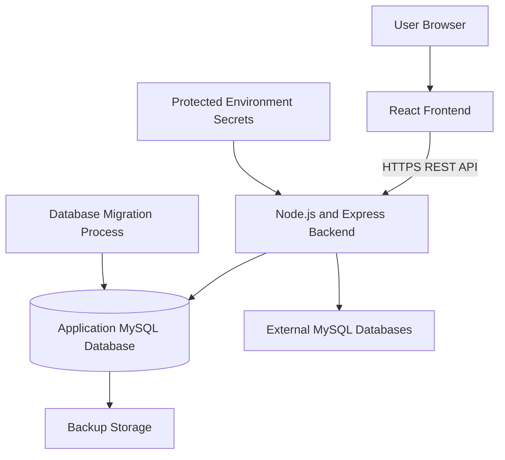

# Queralyth — Deployment and Infrastructure

**Document:** Deployment and Infrastructure  
**Project:** Queralyth  
**Version:** 1.0  
**Status:** Initial deployment design baseline  
**Frontend:** React (JavaScript)  
**Backend:** Node.js + Express  
**Application Database:** MySQL 8.x  
**Initial Hosting Budget:** $0/month

---

## 1. Introduction

### 1.1 Purpose

This document defines the deployment architecture, infrastructure requirements, environment configuration, release procedures, and operational practices for Queralyth.

It describes how the application will be developed, tested, deployed, maintained, and recovered.

### 1.2 Objectives

The deployment strategy must:

1. Support reliable local development.
2. Separate development, testing, and production environments.
3. Keep deployment costs at $0/month initially.
4. Avoid unnecessary vendor lock-in.
5. Protect application secrets and database credentials.
6. Support controlled application releases.
7. Provide a repeatable database migration process.
8. Support backup and recovery procedures.
9. Preserve the application's security boundaries.
10. Allow infrastructure to evolve without requiring a complete architectural redesign.

### 1.3 Deployment Philosophy

Queralyth will begin with a simple, provider-independent deployment model.

The initial implementation will use:

- One React frontend.
- One Node.js and Express backend.
- One MySQL application database.
- A logically separate query-engine package within the backend codebase.
- Separate external MySQL connections for users' databases.

The application will initially remain a modular monolith.

Microservices, Kubernetes, and other complex infrastructure are not MVP requirements.

---

## 2. Deployment Architecture

### 2.1 High-Level Deployment Model



### 2.2 Frontend Deployment

The React frontend is built into static production assets.

These assets may be served through:

- A static hosting provider.
- A compatible web server.
- Another provider-independent static asset hosting solution.

The frontend must communicate with the backend through the documented REST API.

It must never connect directly to the application database or users' external MySQL databases.

### 2.3 Backend Deployment

The backend runs as a Node.js application using Express.

It is responsible for:

- Authentication and session management.
- Authorization.
- Account management.
- Connection management.
- Credential encryption and decryption.
- SQL parsing and validation.
- Query execution coordination.
- Query-history management.
- Application database access.
- External MySQL connectivity.

The backend must run in an environment capable of supporting the required runtime and network operations.

### 2.4 Application Database Deployment

The application database uses MySQL 8.x with InnoDB.

It stores Queralyth's application data and must be accessible to the backend through protected database credentials.

The selected provider must support the required MySQL version or a verified compatible configuration.

### 2.5 External Database Connectivity

Users connect their own MySQL databases through the backend.

The deployment environment must support controlled outbound database connectivity.

The backend must validate destinations and enforce network restrictions to prevent SSRF and unauthorized access to internal infrastructure.

External database access must not be exposed directly to the browser.

---

## 3. Infrastructure Components

### 3.1 Initial Components

| Component | Responsibility | Initial deployment approach |
|---|---|---|
| React frontend | User interface | Static hosting |
| Express backend | Application logic and APIs | Node.js hosting |
| Application database | Persistent application data | MySQL 8.x hosting |
| External MySQL connections | User database access | Backend-managed connections |
| Environment secrets | Sensitive configuration | Protected hosting secrets |
| Database migrations | Schema management | Version-controlled SQL |
| Backups | Recovery | Encrypted backup storage |

### 3.2 Components Not Required Initially

The MVP does not require:

- Kubernetes.
- Dedicated microservices.
- Distributed caching.
- A separate message broker.
- A dedicated analytics database.
- A separate search engine.
- A paid observability platform.
- A complex multi-region deployment.

These may be evaluated later if measurable requirements justify them.

---

## 4. Environment Strategy

### 4.1 Environments

Queralyth will maintain three logical environments:

1. Development.
2. Testing.
3. Production.

### 4.2 Development Environment

The development environment is used for:

- Feature implementation.
- Local debugging.
- Database schema development.
- SQL parser experimentation.
- Query-engine development.
- Component testing.

It should run locally without requiring a deployed production backend.

### 4.3 Testing Environment

The testing environment is used for:

- Integration testing.
- API testing.
- Authentication testing.
- Database migration testing.
- Query-engine testing.
- Security validation.
- Release verification.

It must remain separate from production data and credentials.

### 4.4 Production Environment

Production serves actual users.

It must use:

- Production-specific configuration.
- Production application database credentials.
- Production encryption secrets.
- HTTPS.
- Restricted administrative access.
- Production database migrations.
- Appropriate backup and recovery procedures.

### 4.5 Environment Isolation

Each environment must have separate:

- Application database credentials.
- Session secrets and configuration.
- Encryption keys.
- External service credentials.
- Database instances or databases.
- Deployment configuration.

Production secrets must never be reused in development or testing.

Production user data must not be copied into lower environments without appropriate sanitization.

---

## 5. Local Development Infrastructure

### 5.1 Local Application Structure

The local development environment consists of:

- React frontend.
- Node.js and Express backend.
- Local MySQL application database.
- External test MySQL databases where required.
- Local environment configuration.

### 5.2 Local Execution

The frontend and backend may run as separate development processes.

The backend must connect to the local application database through its configured database pool.

External test database connections must follow the same backend security and validation rules used in production.

### 5.3 Local Configuration

Local environment variables should be stored in an untracked environment file.

An example environment file may be committed as:

`.env.example`

It must contain placeholder values only.

The actual `.env` file must be excluded from Git.

### 5.4 Local Development Requirements

The local environment must support:

- Database migrations.
- Development seed data.
- Backend tests.
- Frontend tests.
- API testing.
- Local logging.
- Query-engine experimentation.

Development seed data must not contain real production credentials or sensitive personal information.

### 5.5 Reproducibility

The project must document:

- Required runtime versions.
- Required dependencies.
- Database setup.
- Environment configuration.
- Migration commands.
- Development startup commands.
- Test commands.

A new development machine should be able to reproduce the environment from the repository and documented prerequisites.

---

## 6. Environment Configuration

### 6.1 Configuration Management

Environment-specific settings must be supplied through environment variables or an equivalent protected configuration facility.

Application code must not contain hardcoded production secrets.

### 6.2 Configuration Categories

Configuration includes:

**Application**
- Application environment.
- Backend port.
- Public frontend origin.
- API base path.
- Logging level.

**Application database**
- Database host.
- Database port.
- Database name.
- Database username.
- Database password.
- Pool configuration.

**Authentication**
- Session cookie configuration.
- Idle expiration.
- Absolute expiration.
- Allowed frontend origins.
- CSRF configuration.

**Credential encryption**
- Encryption key.
- Encryption key version.
- Encryption algorithm configuration.

**External connections**
- Connection establishment timeout.
- Execution concurrency limits.
- Execution resource limits.

**Operational**
- Migration configuration.
- Health-check configuration.
- Backup configuration.
- Retention settings.

### 6.3 Configuration Validation

The backend must validate mandatory configuration at startup.

If a mandatory secret or database setting is missing or invalid:

- Startup must fail safely.
- The application must not silently use insecure defaults.
- The error must identify the missing configuration category without exposing secret values.

### 6.4 Example Environment Template

The repository may include a placeholder template:

```dotenv
NODE_ENV=development
PORT=5000

FRONTEND_ORIGIN=http://localhost:5173

APP_DB_HOST=localhost
APP_DB_PORT=3306
APP_DB_NAME=queralyth
APP_DB_USER=placeholder
APP_DB_PASSWORD=placeholder

SESSION_IDLE_TIMEOUT_DAYS=7
SESSION_ABSOLUTE_TIMEOUT_DAYS=30

CREDENTIAL_ENCRYPTION_KEY=replace_with_secure_secret
CREDENTIAL_ENCRYPTION_KEY_VERSION=v1

LOG_LEVEL=debug
```

This is an illustrative template.

Actual configuration names, formats, and validation rules will be finalized during implementation.

Real secrets must never be placed in this template or committed to Git.

---

## 7. Secrets and Credential Management

### 7.1 Secret Categories

Sensitive values include:

- Application database passwords.
- Session-related secrets.
- External database credential encryption keys.
- Email-service credentials.
- Other privileged integration credentials.

### 7.2 Storage Requirements

Secrets must be stored through:

- Protected environment variables.
- Hosting-provider secret-management facilities.
- An equivalent secure configuration mechanism.

They must not be stored in:

- Source code.
- Public frontend assets.
- Git repositories.
- Database configuration tables in plaintext.
- Application logs.
- Error responses.

### 7.3 External Database Credentials

External database passwords are encrypted using AES-256-GCM before being persisted.

Encryption and decryption occur exclusively in the backend.

The encryption key is stored separately from the application database.

### 7.4 Encryption-Key Protection

The initial MVP uses a protected backend environment secret.

The implementation must:

- Keep the key out of source control.
- Keep the key out of the application database.
- Support key versioning.
- Support controlled key rotation.
- Restrict access to the backend process.
- Document secure key backup and recovery.

Losing the encryption key can make stored credentials permanently unrecoverable.

### 7.5 Key Rotation

Key rotation must not invalidate all saved connection credentials unexpectedly.

The backend must be able to identify which key version encrypted a credential.

A controlled re-encryption process must migrate credentials to the new key version.

Old keys must remain available only as long as required for safe migration and recovery.

### 7.6 Future Key Management

A dedicated Key Management Service may be introduced if product growth justifies it.

The initial architecture must not require a paid KMS.

---

## 8. Frontend Deployment

### 8.1 Build Process

The React application must support a reproducible production build.

The build process should:

1. Install dependencies from the lockfile.
2. Run relevant quality checks.
3. Build production assets.
4. Produce static output.
5. Publish the generated assets to the selected hosting provider.

### 8.2 Frontend Configuration

Frontend configuration may include public values such as:

- Backend API base URL.
- Public application name.
- Public environment identifier.

No database credentials, encryption keys, session secrets, or privileged tokens may be included in frontend build variables.

### 8.3 Browser Security

The deployed frontend must communicate with the backend over HTTPS.

The backend must configure appropriate:

- CORS policy.
- Session cookie attributes.
- CSRF protections.
- Security headers.

The production configuration must not rely on permissive development CORS settings.

### 8.4 Static Asset Delivery

Production assets should use appropriate caching behavior.

Versioned assets may use long-lived cache headers.

HTML entry points should use cache behavior that allows users to receive updated application versions after deployment.

---

## 9. Backend Deployment

### 9.1 Runtime

The backend requires a supported Node.js runtime.

The selected runtime version must be pinned or explicitly specified in the repository.

### 9.2 Startup Process

Backend startup must:

1. Load environment configuration.
2. Validate mandatory settings.
3. Initialize required application services.
4. Initialize the application database pool.
5. Verify required dependencies.
6. Register API routes.
7. Start listening for requests.
8. Expose appropriate health and readiness checks.

The backend must not report readiness before mandatory dependencies are available.

### 9.3 Graceful Shutdown

On shutdown, the backend should:

1. Stop accepting new requests.
2. Stop creating new execution claims.
3. Allow bounded in-flight operations to resolve.
4. Signal appropriate execution cancellation where necessary.
5. Close database pools when safe.
6. Preserve unresolved execution state.
7. Exit within the platform's available shutdown window.

If an external query may still be running when the worker shuts down, the execution must remain recoverable rather than being falsely marked as cancelled.

### 9.4 Process Restarts

The backend must tolerate restarts without assuming that all external database operations have stopped.

Active execution requests must be reconciled using their persisted lifecycle state and recovery mechanisms.

---

## 10. Application Database Deployment

### 10.1 Database Requirements

The selected application database must support:

- MySQL 8.x compatibility.
- InnoDB.
- Foreign keys.
- Transactions.
- Required indexes and constraints.
- Connection pooling.
- Secure remote access where necessary.

### 10.2 Database Access

Only the backend should access the application database during normal application operation.

The frontend must never receive application database credentials.

### 10.3 Database User Privileges

The application database account must receive only the permissions required by the application.

Schema migration permissions should be separated from ordinary runtime permissions where practical.

### 10.4 Database Configuration

The database must use:

- `utf8mb4`.
- Appropriate MySQL 8.x collation.
- UTC timestamps.
- Required InnoDB configuration.
- Explicit connection limits.
- Appropriate backup and recovery procedures.

### 10.5 Provider Compatibility

The application must not depend on provider-specific database extensions unless explicitly approved through a technical decision record.

---

## 11. Database Migration and Release Coordination

### 11.1 Migration Source

All schema migrations are maintained in version control.

Each migration has a unique sequential identifier.

A migration tracking table records applied migrations.

### 11.2 Deployment Order

A release involving database changes must follow a controlled sequence:

1. Prepare the release.
2. Validate the migration against a test database.
3. Back up production data where appropriate.
4. Apply the production migration.
5. Deploy the compatible backend version.
6. Deploy the compatible frontend version.
7. Run health and smoke tests.
8. Verify critical application workflows.

The exact order may vary for backward-compatible changes, but the application must never operate against an incompatible schema.

### 11.3 Migration Safety

Migrations must:

- Be reviewed.
- Be tested.
- Avoid unnecessary destructive operations.
- Preserve data where required.
- Include rollback considerations.
- Be treated as immutable after application.

### 11.4 Application Compatibility

Where possible, schema changes should support a transition period during which both the old and new application versions can operate safely.

For incompatible changes, a coordinated deployment and migration plan is required.

---

## 12. Continuous Integration and Deployment

### 12.1 Initial CI Strategy

The project should use automated checks when supported by the selected repository and hosting platform.

Initial checks include:

- Dependency installation.
- Backend linting.
- Frontend linting.
- Unit tests.
- Integration tests where infrastructure is available.
- Production build verification.
- Migration validation.

### 12.2 Deployment Trigger

The initial release process may deploy from a protected main branch after the required checks pass.

Development work should be performed in feature branches.

### 12.3 Release Verification

Every deployment must be verified through:

- Backend health checks.
- Application database readiness.
- Frontend loading.
- Authentication workflow.
- Connection-management workflow.
- Basic query-analysis workflow.
- A controlled external MySQL connection test where available.

### 12.4 Failed Deployment

If deployment fails:

- Do not report the release as successful.
- Preserve diagnostic logs.
- Determine whether the database migration completed.
- Restore the last compatible application version when safe.
- Apply a forward-fix migration if rollback is unsafe.
- Verify application readiness before reopening normal traffic.

### 12.5 CI/CD Cost Constraint

The initial CI/CD process should use available free tooling.

The architecture must not require a paid deployment pipeline.

Free-tier usage limits and execution quotas must be checked before selection.

---

## 13. Domain, HTTPS, and Network Configuration

### 13.1 Domain Strategy

The initial deployment may use free provider subdomains.

Purchasing a custom domain is not an MVP requirement.

### 13.2 HTTPS

All production application traffic must use HTTPS.

The backend must reject or securely redirect inappropriate insecure access according to the hosting configuration.

Secure cookies must be enabled in production.

### 13.3 Frontend and Backend Origins

The frontend and backend may use separate origins.

If so, the backend must explicitly allow the intended frontend origin.

Credentialed cross-origin requests must use a narrowly defined CORS configuration.

Wildcard origins must not be combined with credentialed requests.

### 13.4 External MySQL Networking

The backend hosting environment must support outbound connections to permitted MySQL destinations.

The deployment design must account for:

- Provider outbound-network restrictions.
- Firewall policies.
- DNS resolution.
- Connection limits.
- Network timeouts.
- Private and internal destination restrictions.

The system must not expose arbitrary network access through user-submitted connection details.

### 13.5 SSRF Protection

Connection destination validation must be enforced by the backend.

The production environment must prevent access to prohibited internal infrastructure, metadata endpoints, and other restricted network destinations.

Frontend validation alone is insufficient.

---

## 14. Backup and Disaster Recovery

### 14.1 Backup Responsibility

The application database must be backed up according to the policy defined in `08-Performance-and-Scalability.md`.

Initial target:

- Daily backups.
- Seven-day retention.
- Encrypted and access-restricted storage.

### 14.2 Backup Verification

Backups must be periodically restored into an isolated environment to verify usability.

Backup creation alone is not sufficient evidence of recoverability.

### 14.3 Encryption-Key Recovery

The credential encryption key must have a separate protected backup and recovery procedure.

The database backup and key backup must be coordinated so that restored encrypted credentials remain decryptable.

### 14.4 Disaster Recovery

Recovery procedures must document:

1. Infrastructure provisioning.
2. Database restoration.
3. Migration-version verification.
4. Encryption-key restoration.
5. Backend configuration.
6. Backend deployment.
7. Frontend deployment.
8. Health verification.
9. Execution-state reconciliation.
10. Controlled return to service.

### 14.5 RPO and RTO

Recovery Point Objective and Recovery Time Objective must be established before production readiness.

Actual values depend on the selected provider, backup frequency, and recovery capabilities.

No uptime or recovery guarantee should be claimed without supporting evidence.

---

## 15. Logging and Operational Monitoring

### 15.1 Logging

The backend should produce structured operational logs.

Logs should include:

- Timestamp.
- Severity.
- Request identifier.
- Component.
- Operation category.
- Duration.
- Error category.
- Relevant operational context.

### 15.2 Sensitive Data Protection

Logs must not contain:

- Passwords.
- Raw session tokens.
- Encryption keys.
- Decrypted database credentials.
- Unnecessary SQL parameters.
- Sensitive request payloads.

Full SQL statements must not be logged by default.

### 15.3 Monitoring

Initial monitoring should cover:

- Backend process health.
- Application database connectivity.
- Connection-pool usage.
- Database errors.
- External connection failures.
- Execution duration.
- Concurrency utilization.
- Request errors.
- Memory and CPU usage where supported.

### 15.4 Operational Alerts

The initial deployment may use lightweight provider-supported alerts or periodic operational checks.

A paid monitoring platform is not mandatory.

### 15.5 Health Endpoints

Health endpoints must not expose:

- Secret values.
- Database passwords.
- Internal connection strings.
- Detailed infrastructure topology.
- Sensitive stack traces.

Liveness and readiness checks must remain distinct.

---

## 16. Deployment Security

### 16.1 Repository Security

The Git repository must not contain:

- `.env` files with real secrets.
- Private encryption keys.
- Database passwords.
- Session tokens.
- Production backups.
- Sensitive user data.

### 16.2 Dependency Security

Dependencies must be reviewed and maintained.

The project should:

- Use lockfiles.
- Review dependency updates.
- Remove unnecessary packages.
- Monitor known security vulnerabilities.
- Update vulnerable dependencies appropriately.

### 16.3 Deployment Access

Deployment credentials and hosting access must be restricted.

Only authorized maintainers should be able to modify production configuration or deploy releases.

### 16.4 Database Privileges

Runtime database users must have least-privilege permissions.

Administrative and migration privileges must not be unnecessarily exposed to normal application operations.

### 16.5 Production Debugging

Production debug modes must be disabled.

Stack traces and detailed internal errors must not be exposed to users.

---

## 17. Zero-Cost Hosting Strategy

### 17.1 Budget Commitment

The initial deployment target is:

**$0/month**

A paid option around $1/month is negotiable only if it provides a necessary capability that cannot reasonably be obtained through the free options.

### 17.2 Provider Selection Criteria

Any candidate provider must be evaluated against:

| Requirement | Evaluation |
|---|---|
| Node.js support | Required |
| React static hosting | Required |
| MySQL 8.x compatibility | Required |
| Outbound MySQL connectivity | Required |
| Protected environment secrets | Required |
| HTTPS | Required |
| Persistent application data | Required |
| Connection limits | Must be verified |
| Backup support | Must be evaluated |
| Free-tier restrictions | Must be documented |
| Provider lock-in | Should be minimized |

### 17.3 Free-Tier Limitations

The team must verify whether a free service imposes:

- Sleep or inactivity suspension.
- Limited execution time.
- Limited database storage.
- Restricted outbound connections.
- Connection quotas.
- Build-minute quotas.
- Bandwidth limits.
- Data expiration.
- Backup restrictions.

### 17.4 Fallback Strategy

If one provider cannot satisfy the deployment requirements:

1. Evaluate another compatible free provider.
2. Keep frontend and backend hosting independent where useful.
3. Retain local development as a fully functional environment.
4. Reconsider a small paid option only if necessary.
5. Document the resulting decision.

### 17.5 Reliability Qualification

Free hosting may not provide always-on availability, production-grade backups, or sufficient resources.

The application must be honest about these limitations.

The zero-cost constraint takes priority during the initial MVP unless the user explicitly changes the budget decision.

---

## 18. Release and Rollback Strategy

### 18.1 Release Preparation

Before each release:

1. Review the changes.
2. Run automated tests.
3. Validate production builds.
4. Review database migrations.
5. Verify configuration requirements.
6. Check for accidental secrets.
7. Prepare recovery steps.

### 18.2 Deployment

A release should deploy compatible backend and frontend versions.

Database changes must be coordinated with application compatibility.

### 18.3 Post-Deployment Verification

After deployment:

- Check backend readiness.
- Check application database connectivity.
- Load the frontend.
- Test authentication.
- Test connection management.
- Test SQL parsing and analysis.
- Perform controlled execution testing where available.
- Review operational logs.

### 18.4 Rollback

If a release introduces a critical defect:

- Restore a compatible previous application version where possible.
- Assess database migration compatibility first.
- Do not blindly reverse destructive database migrations.
- Use a forward-fix migration where necessary.
- Verify data integrity before resuming normal operations.

---

## 19. Deployment Acceptance Criteria

The initial deployment architecture is acceptable when:

1. The React frontend can be built and deployed independently.
2. The Express backend can run in the selected environment.
3. The application database supports the required MySQL 8.x features.
4. The backend can securely access the application database.
5. The backend can establish permitted external MySQL connections.
6. Frontend and backend communication uses HTTPS in production.
7. Production secrets are protected and absent from source control.
8. External database credentials are encrypted at rest.
9. Database migrations can be applied reproducibly.
10. Liveness and readiness checks operate correctly.
11. Backup and restoration procedures are documented and tested.
12. Failed deployments can be handled without falsely reporting success.
13. Deployment remains within the approved initial budget.
14. Provider limitations are documented.

---

## 20. Decisions Deferred Until Implementation

The following details remain intentionally open:

1. Final frontend hosting provider.
2. Final backend hosting provider.
3. Final application MySQL hosting provider.
4. Whether frontend and backend share a domain or use separate origins.
5. Exact Node.js runtime version.
6. Final production build and deployment pipeline.
7. Backup storage provider.
8. Exact production environment-variable names.
9. Final domain and DNS configuration.
10. Provider-specific shutdown and restart behavior.
11. Final monitoring and alerting implementation.
12. Production RPO and RTO targets.

These decisions must be based on actual provider capabilities, testing, cost, and security requirements.

They must be documented in `12-Technical-Decision-Records.md` when finalized.

---

## 21. Related Documents

- `01-System-Architecture.md`
- `02-Component-Design.md`
- `03-Database-Design.md`
- `04-API-Design.md`
- `05-Authentication-and-Security.md`
- `06-Query-Execution-Engine.md`
- `07-Concurrency-and-Transactions.md`
- `08-Performance-and-Scalability.md`
- `10-Error-Handling-and-Recovery.md`
- `11-Testing-and-Quality-Strategy.md`
- `12-Technical-Decision-Records.md`

---

## 22. Document Maintenance

This document defines the initial deployment and infrastructure baseline for Queralyth.

Provider-specific decisions must be made only after verifying the required runtime, database, networking, security, and cost capabilities.

Any deployment change affecting architecture, security, data persistence, or recovery must be reflected in the relevant system design documentation.

## Audit-approved deployment clarifications

### Built-in sample database

Provision a synthetic MySQL 8.x sample schema that is logically separate from the Queralyth application schema. A shared physical MySQL server is acceptable for the initial zero-cost deployment only when the provider supports separate schemas and distinct database users/grants. The sample-query account must have read-only privileges limited to the sample schema; the application database account must not be used for user sample queries. If the chosen provider cannot enforce this separation, do not expose the sample target in that deployment. Seed data and schema changes must be version-controlled and repeatable.

### MVP result-cache deployment constraint

The MVP temporary result cache is process-local, bounded, in-memory, and uses a 15-minute default TTL. This design assumes one backend instance. Configure a finite cache memory budget and per-entry limit appropriate to the host's memory. A backend restart clears cached result data but does not erase durable execution status; a new process cache-generation identifier lets the API report `backend_restart`. Same-process expiry/eviction reasons use bounded in-memory tombstones; if unavailable, report generic `unavailable`. Horizontal scaling is not compatible with this cache design unless a shared ephemeral store or validated request-affinity strategy is introduced first.

